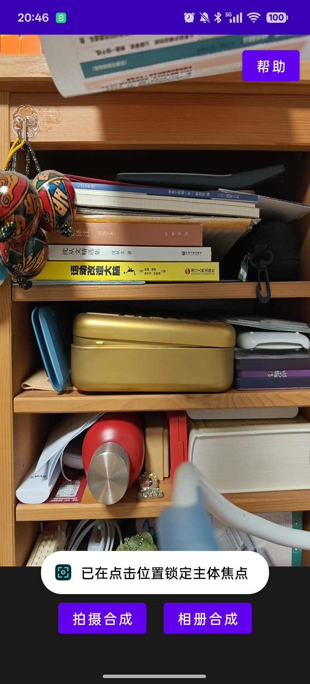
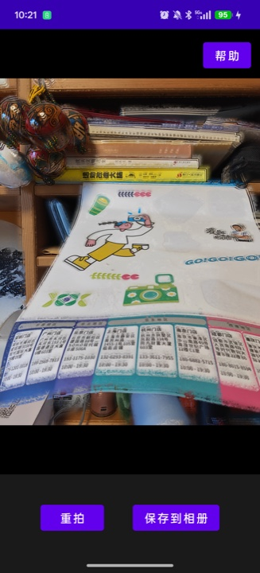
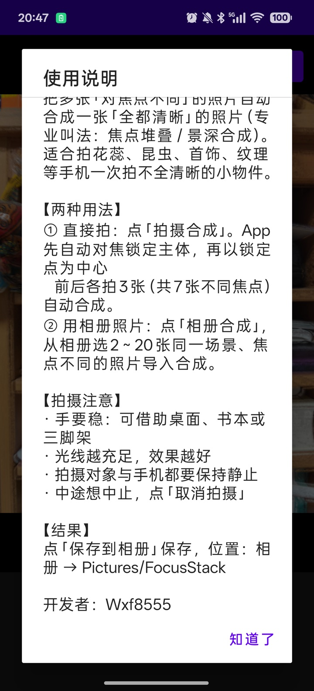
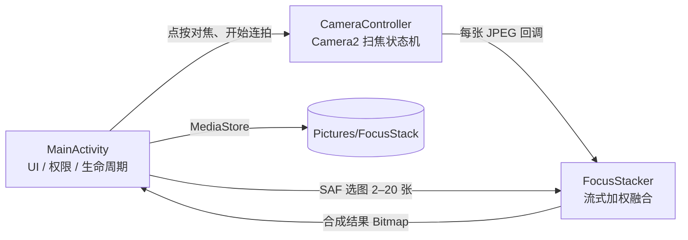
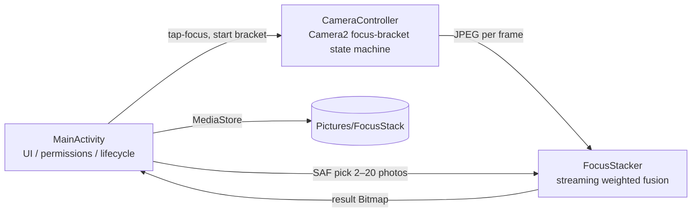

# 景深合成相机 · FocusStack

> 用手机完成照片焦点堆叠（景深合成）：拍多张不同对焦位置的照片，自动合成一张「处处清晰」的微距/静物照片。
> A focus-stacking camera for Android: capture a focus bracket and fuse it into one all-in-focus image.


[](https://github.com/wxfly515616-lab/FocusStack/actions/workflows/android.yml)
[](https://github.com/wxfly515616-lab/FocusStack/releases)
[](LICENSE)
[](https://github.com/wxfly515616-lab/FocusStack/stargazers)

> ⭐ 如果这个项目对你有帮助，欢迎点一下右上角的 **Star** —— 这是对开发者最大的鼓励，也能让更多人发现它。
> ⭐ If this project helps you, please give it a Star — it helps others discover it too!

[简体中文](#简体中文) | [English](#english) · [开发文档](docs/DEVELOPMENT.md) · [路线图](docs/ROADMAP.md) · [贡献指南](CONTRIBUTING.md)

<p align="center">
  
  
  
</p>

---

## 简体中文

### 项目简介

手机镜头在近距离拍摄时景深很浅：拍花蕊，花瓣清晰了花心就虚；拍昆虫，复眼清晰了翅膀就虚。**焦点堆叠（Focus Stacking，也称景深合成）** 就是围绕同一构图拍摄多张对焦点不同的照片，再把每张里最清晰的部分拼成一张「全都清晰」的图。

这个 App 把整个流程放进手机里完成，不依赖电脑、不依赖 Photoshop：

1. 手机固定好，点一下屏幕锁定主体焦点；
2. App 以这个焦点为中心，前、后各拍若干张不同对焦距离的照片（最多 7 张）；
3. 边拍边合成，最后输出一张全清晰的图并保存到相册。

适合拍花蕊、昆虫、首饰、手表、纹理、电路板等「一次拍不全清晰」的小物件，也适合任何需要大景深的静物题材。

### 功能特性

- **自动焦点包围**：自动对焦锁定主体后，以锁定距离为中心前后各 3 档，最多拍 7 张；每一档都等镜头真正到位、停稳后才按快门。
- **流式合成**：每拍完一张立即在后台开始计算，与后续拍摄并行，内存中只保留一张工作图，显著降低中低端手机闪退概率。
- **加权融合**：基于拉普拉斯边缘强度评估清晰度，平滑后按「越清晰权重越大」逐像素融合；全无细节的区域自然平均降噪，避免把虚化区的噪点当成清晰像素带进结果。
- **亮度与白平衡对齐**：以第一张为基准做逐通道增益补偿，避免不同帧之间的亮度/色偏形成斑块。
- **相册导入**：也可以从相册选 2–20 张同场景、不同焦点的照片导入合成，不要求用本 App 拍摄。
- **点按对焦**：点屏幕任意位置对焦并锁定，作为焦点包围的中心。
- **保存到相册**：Android 10+ 使用 MediaStore，Android 9 及以下兼容旧存储权限；保存位置 `相册 → Pictures/FocusStack`。
- **生命周期安全**：切后台自动释放相机，回前台自动重开；拍摄可随时取消。
- **纯 Kotlin、零图像库依赖**：算法全部手写，易于阅读、修改和移植。

### 当前状态

v2.0 的核心流程（扫焦连拍 → 合成 → 保存、相册导入 → 合成 → 保存）已在真机上跑通，仓库截图来自实际运行。但项目仍处于**早期开发阶段**：

- 尚未做系统化测试、没有单元测试与多机型验证；
- 没有几何对齐，手持或支架微动会产生重影；
- 输出为约 300 万像素（相机路径旋转后约 1500×2000），不是完整的 1200 万像素采集尺寸。

这些正是需要一起完成的部分，欢迎从[路线图](docs/ROADMAP.md)里挑一个任务开始。

### 快速开始

**手机要求**：Android 8.0（API 26）及以上、有后置摄像头，且相机支持手动对焦距离控制（大多数中高端机型支持；不支持时 App 会提示"该机型不支持手动对焦距离控制"）。

#### 方式一：Android Studio

1. 安装 Android Studio（建议最新稳定版）与 Android SDK 34；
2. `File → Open` 选择项目根目录，等待 Gradle 同步完成；
3. 手机开启「开发者选项 → USB 调试」，用数据线连接电脑；
4. 点击 Run（▶）即可安装到手机。

#### 方式二：命令行

```bash
# 需要 JDK 17 和 Android SDK 34
export JAVA_HOME=/path/to/jdk-17
export ANDROID_HOME=/path/to/Android/sdk

# Debug 包
./gradlew assembleDebug
# 产物：app/build/outputs/apk/debug/app-debug.apk

# 安装到已连接的手机
adb install -r app/build/outputs/apk/debug/app-debug.apk
```

也可以使用作者本机的辅助脚本（路径需要按自己机器修改，详见开发文档）：

```bash
./build_apk.sh debug   # 编译 debug 包
./install_apk.sh       # 通过 adb 安装
```

> **签名提示**：正式包签名依赖本地 `keystore.properties` 和 `*.jks`，它们已被 `.gitignore` 排除，**不会**上传到仓库。普通贡献者用 debug 包即可；发布正式版请使用你自己的签名文件。

### 使用说明

#### 拍摄合成

1. 用支架、桌面或书本把手机固定住，拍摄全程手机和主体都不能动；
2. 打开 App，点屏幕上的主体位置完成对焦（出现对焦框，提示"已锁定"）；
3. 点「拍摄合成」，等待自动拍摄最多 7 张并合成；
4. 合成完成后可点「保存到相册」，或点「重拍」返回预览；
5. 拍摄过程中可点「取消拍摄」中止。

#### 相册合成

点「相册合成」，从相册选择 2–20 张**同一场景、不同焦点**的照片。建议按对焦位置从近到远顺序选择。Android 9 及以上会自动按 EXIF 方向摆正，Android 8.x 不会（竖拍照片请先自行转正）。建议单张不超过 1200 万像素，像素过高会显著增加内存压力。

#### 拍摄建议

- **稳定第一**：三脚架 > 桌面/书本 > 手持（当前版本没有图像对齐，手持几乎必然重影）；
- **光线充足**：弱光下噪点会让清晰度判断失准；
- **主体静止**：风吹动的花、会动的昆虫都很难合成；
- **对焦点覆盖**：如果主体前后景深跨度很大，可先点一个中间位置作为包围中心，或改用相册导入手工控制对焦位置。

### 从源码构建

| 项目 | 版本 |
| --- | --- |
| JDK | 17 |
| Kotlin | 1.9.22 |
| Android Gradle Plugin | 8.2.2 |
| Gradle | 8.4（包含 wrapper） |
| compileSdk / targetSdk | 34 |
| minSdk | 26（Android 8.0） |

构建前的准备：

1. 安装 JDK 17 与 Android SDK Platform 34（含 build-tools、platform-tools）；
2. 在项目根目录创建 `local.properties`，写入 `sdk.dir=/你的/Android/Sdk`（该文件不会提交）；
3. 执行 `./gradlew assembleDebug`，或直接用 Android Studio 打开运行。

详细的环境搭建、模块职责、算法原理与调试方法见 **[开发文档 docs/DEVELOPMENT.md](docs/DEVELOPMENT.md)**。

### 项目结构

```text
FocusStack_v2/
├── app/
│   └── src/main/
│       ├── AndroidManifest.xml              # 权限、相机特性、Activity 声明
│       ├── java/com/example/focusstack/
│       │   ├── MainActivity.kt              # UI、权限、生命周期、相册导入、保存
│       │   ├── CameraController.kt          # Camera2 封装：预览、点按对焦、焦点包围连拍
│       │   └── FocusStackProcessor.kt       # FocusStacker：清晰度评估与加权融合内核
│       └── res/                             # 布局、图标、颜色、主题
├── docs/
│   ├── DEVELOPMENT.md                       # 架构与开发文档（中英双语）
│   ├── ROADMAP.md                           # 路线图与可认领任务（中英双语）
│   └── images/                              # README 截图
├── build_apk.sh                             # 作者本机一键编译脚本
├── install_apk.sh                           # 作者本机一键安装脚本
├── CONTRIBUTING.md                          # 贡献指南（中英双语）
└── gradle/ gradlew gradlew.bat              # Gradle Wrapper
```

### 技术架构速览



- **CameraController**：自动对焦锁定主体 → 读取镜头实际对焦距离（屈光度）→ 以它为中心生成扫焦序列 → 每档等镜头停稳后拍 JPEG → 通过回调流式交给合成线程。所有相机操作在独立 `HandlerThread` 上执行。
- **FocusStacker**：逐张降采样解码（12MP → 3MP）→ 灰度 → 拉普拉斯边缘强度 → 箱式模糊平滑 → 以该帧平均清晰度归一化 → 权重 `1 + (score/basis)^12` → 逐通道增益对齐 → 加权累加 → 归一化输出。计算按行分块，在线程池中并行。
- **MainActivity**：处理权限、生命周期（后台释放相机）、相册导入、保存与界面状态；合成与保存分别跑在单线程执行器上，避免阻塞 UI。

算法细节、参数表、线程与内存模型见[开发文档](docs/DEVELOPMENT.md)。

### 已知限制

1. **没有图像几何对齐**：手持拍摄会重影，这是当前最大的画质瓶颈。另外手机镜头改变对焦距离时视场角会轻微变化（呼吸效应，实测边缘可达约 35 像素位移），这也是当前只能做加权融合、不能用"逐像素挑最清晰一张"的原因。
2. **输出只有约 3MP**（像素约 2000×1500，相机路径旋转后为约 1500×2000）：为了在手机上稳定运行做的取舍，全分辨率需要分块合成。
3. **依赖机型支持手动对焦**：不支持 `LENS_FOCUS_DISTANCE` 的机型无法使用连拍合成。
4. **界面仅中文**：文案硬编码，尚未迁移到 `strings.xml`，没有英文界面。
5. **缺少自动化测试与多机型验证**。
6. **部分机型对焦步长/范围差异大**：尚未做按机型校准，个别设备可能对焦点覆盖不理想。
7. **导入高像素照片有 OOM 风险**：工作尺寸由第一张照片决定，4800 万像素照片会占用大量内存，建议单张 ≤1200 万像素。

### 路线图

完整、可认领的任务清单见 **[docs/ROADMAP.md](docs/ROADMAP.md)**，优先级最高的方向：

- [ ] 图像几何对齐（平移/旋转配准）→ 支持手持与更稳定的合成
- [ ] 全分辨率（12MP）分块合成
- [ ] 按机型校准焦点包围策略
- [ ] 单元测试（JVM 合成内核）+ GitHub Actions CI
- [ ] UI 国际化与英文界面
- [ ] 代码清理与工程化（重命名、去死代码、调试开关）

### 参与贡献

非常欢迎一起把这个项目做完！无论是修 Bug、加功能、做机型适配、写测试还是改文档都有价值。

1. 阅读 **[CONTRIBUTING.md](CONTRIBUTING.md)** 了解流程与规范；
2. 在 [Issues](../../issues) 里找带 `good first issue` 或 `help wanted` 标签的任务，也可以直接提 Bug/需求；
3. Fork → 新建分支 → 提交 PR，PR 里说明测试方式和设备信息；
4. 涉及 UI 的改动请附截图，涉及拍摄/合成的改动请说明真机验证结果。

> 安全提醒：请勿提交 `keystore.properties`、`*.jks`、`local.properties`、`build/` 以及调试帧目录。

### 文档索引

| 文档 | 内容 |
| --- | --- |
| [README.md](README.md) | 项目介绍、使用说明、快速开始 |
| [docs/DEVELOPMENT.md](docs/DEVELOPMENT.md) | 架构、Camera2 流程、合成算法、参数表、环境搭建、调试 |
| [docs/ROADMAP.md](docs/ROADMAP.md) | 路线图与可认领任务（含验收标准） |
| [CONTRIBUTING.md](CONTRIBUTING.md) | 贡献流程、代码规范、PR 检查清单 |

### 开源协议

本项目基于 [MIT License](LICENSE) 开源，可自由使用、修改和分发，保留版权声明即可。

---

## English

### Overview

A phone lens has a very shallow depth of field at close range: focus on the petals of a flower and the center goes soft; focus on an insect's eye and the wings blur. **Focus stacking** solves this by capturing several photos of the same composition with different focus distances, then combining the sharpest parts of each frame into a single all-in-focus image.

FocusStack does the whole job on the phone — no desktop, no Photoshop:

1. Steady the phone and tap the subject to lock focus;
2. The app captures up to 7 photos around that focus distance (three steps in front, three behind);
3. Images are fused while still shooting, and the all-in-focus result can be saved to the gallery.

It is aimed at flowers, insects, jewelry, watches, textures, PCBs — any small subject that cannot be fully in focus in one shot.

### Features

- **Automatic focus bracketing**: lock focus on the subject, then shoot three steps in front and three behind the locked distance (up to 7 frames). Each frame is taken only after the lens has actually settled.
- **Streaming fusion**: every JPEG is handed to the stacker as soon as it arrives, so fusion overlaps with the remaining captures. Only one working bitmap stays in memory, which greatly reduces crashes on mid-range phones.
- **Weighted fusion**: sharpness is estimated with a Laplacian edge response, smoothed, and used as a per-pixel weight — sharper frames dominate. Regions with no detail are averaged, which suppresses noise instead of letting out-of-focus noise win.
- **Brightness / white-balance alignment**: per-channel gains relative to the first frame prevent banding from exposure differences.
- **Gallery import**: fuse 2–20 existing photos of the same scene taken at different focus distances.
- **Tap-to-focus**: tap anywhere on the preview to focus and lock, which becomes the center of the bracket.
- **Gallery save**: MediaStore on Android 10+, legacy storage with runtime permission on Android 9 and below. Output goes to `Pictures/FocusStack`.
- **Lifecycle-safe**: the camera is released when the app goes to the background and reopened on return; captures can be cancelled at any time.
- **Pure Kotlin, no imaging library**: the whole algorithm is hand-written and easy to read, modify and port.

### Project status

The v2.0 core flows (bracket capture → fuse → save, and gallery import → fuse → save) work on a real device; the screenshots in this repository come from actual runs. The project is still at an **early stage**:

- No systematic tests, no unit tests, no multi-device validation yet;
- No geometric alignment — handheld shots and slight tripod movement cause ghosting;
- Output is about 3 MP (~2000×1500 pixels; ~1500×2000 after the camera-path rotation), not the full 12 MP capture.

These are exactly the areas where help is needed — pick a task from the [roadmap](docs/ROADMAP.md) and jump in.

### Quick start

**Device requirements**: Android 8.0 (API 26) or newer, a rear camera, and support for manual focus distance control (`LENS_FOCUS_DISTANCE`). Most mid-range and flagship phones support it; otherwise the app reports that the device does not support manual focus control.

#### Option 1: Android Studio

1. Install Android Studio (latest stable) and Android SDK 34;
2. `File → Open` the project root and wait for Gradle sync;
3. Enable "Developer options → USB debugging" on the phone and connect it;
4. Press Run (▶).

#### Option 2: Command line

```bash
# Requires JDK 17 and Android SDK 34
export JAVA_HOME=/path/to/jdk-17
export ANDROID_HOME=/path/to/Android/sdk

./gradlew assembleDebug
# Output: app/build/outputs/apk/debug/app-debug.apk

adb install -r app/build/outputs/apk/debug/app-debug.apk
```

The author's helper scripts are also available (paths must be adapted to your machine):

```bash
./build_apk.sh debug   # build a debug APK
./install_apk.sh       # install via adb
```

> **Signing note**: release builds rely on a local `keystore.properties` and `*.jks` file, both excluded by `.gitignore` and **never** committed. Contributors should use debug builds; use your own keystore for releases.

### Usage

#### Capture and stack

1. Steady the phone with a tripod, desk or books — neither the phone nor the subject may move during the capture;
2. Tap the subject on the preview to focus (a focus ring appears and the app confirms the lock);
3. Tap **Capture & stack**; the app takes up to 7 focus-bracketed photos and fuses them;
4. Tap **Save to gallery**, or **Retake** to return to the preview;
5. Tap **Cancel capture** to abort at any time.

#### Stack from the gallery

Tap **Stack from gallery** and select 2–20 photos of the **same scene at different focus distances**. Selecting them in near-to-far focus order is recommended. On Android 9+ imported photos are automatically rotated according to their EXIF orientation (Android 8.x does not apply EXIF rotation). Keep each source photo at or below 12 MP to avoid memory pressure.

#### Shooting tips

- **Stability first**: tripod > desk/books > handheld. There is no geometric alignment yet, so handheld shots will almost certainly ghost.
- **Good light**: noise in low light confuses the sharpness estimate.
- **Static subject**: moving flowers or insects are very hard to stack.
- **Cover the range**: if the subject spans a large depth range, lock focus near the middle of the range, or import manually focused photos.

### Building from source

| Item | Version |
| --- | --- |
| JDK | 17 |
| Kotlin | 1.9.22 |
| Android Gradle Plugin | 8.2.2 |
| Gradle | 8.4 (wrapper included) |
| compileSdk / targetSdk | 34 |
| minSdk | 26 (Android 8.0) |

Before building:

1. Install JDK 17 and Android SDK Platform 34 (with build-tools and platform-tools);
2. Create `local.properties` in the project root with `sdk.dir=/path/to/Android/Sdk` (not committed);
3. Run `./gradlew assembleDebug`, or open the project in Android Studio.

See **[docs/DEVELOPMENT.md](docs/DEVELOPMENT.md)** for environment setup, module responsibilities, algorithm details and debugging.

### Repository layout

```text
FocusStack_v2/
├── app/
│   └── src/main/
│       ├── AndroidManifest.xml              # permissions, camera features, activity
│       ├── java/com/example/focusstack/
│       │   ├── MainActivity.kt              # UI, permissions, lifecycle, import, saving
│       │   ├── CameraController.kt          # Camera2: preview, tap-focus, focus bracket
│       │   └── FocusStackProcessor.kt       # FocusStacker: sharpness & weighted fusion
│       └── res/                             # layouts, icons, colors, themes
├── docs/
│   ├── DEVELOPMENT.md                       # architecture & development guide (zh/en)
│   ├── ROADMAP.md                           # roadmap & claimable tasks (zh/en)
│   └── images/                              # README screenshots
├── build_apk.sh                             # author's local build helper
├── install_apk.sh                           # author's local install helper
├── CONTRIBUTING.md                          # contribution guide (zh/en)
└── gradle/ gradlew gradlew.bat              # Gradle Wrapper
```

### Architecture at a glance



- **CameraController**: auto-focus locks the subject → reads the actual lens focus distance (diopters) → builds a focus sweep around it → for each step waits until the lens settles, captures a JPEG, and streams it to the stacker. All camera work runs on a dedicated `HandlerThread`.
- **FocusStacker**: decode each frame downsampled (12 MP → 3 MP) → grayscale → Laplacian edge response → box blur → normalize by the frame's mean sharpness → weight `1 + (score/basis)^12` → per-channel gain alignment → weighted accumulation → normalization. Rows are processed in parallel by a small thread pool.
- **MainActivity**: permissions, lifecycle (release camera in background), gallery import, saving and UI state. Fusion and saving run on dedicated single-thread executors so the UI never blocks.

See the [development guide](docs/DEVELOPMENT.md) for algorithm details, parameter tables, threading and memory model.

### Known limitations

1. **No geometric alignment**: handheld shots ghost; this is the main quality bottleneck. The lens also changes its field of view slightly with focus distance (focus breathing — measured edge displacement of up to ~35 px), which is why fusion is weighted rather than a per-pixel winner-takes-all.
2. **~3 MP output** (~2000×1500 pixels; ~1500×2000 after the camera-path rotation): a deliberate trade-off for stable on-device performance. Full resolution requires tiled fusion.
3. **Requires manual-focus support**: devices that do not expose `LENS_FOCUS_DISTANCE` cannot use bracket capture.
4. **Chinese-only UI**: strings are hard-coded and not yet extracted to `strings.xml`.
5. **No automated tests or multi-device validation yet**.
6. **Focus steps vary by device**: the bracket is not calibrated per model, so coverage may be suboptimal on some phones.
7. **High-resolution imports risk OOM**: the working size is derived from the first photo, so a 48 MP photo consumes a lot of memory; keep imports at or below 12 MP.

### Roadmap

See **[docs/ROADMAP.md](docs/ROADMAP.md)** for the full, claimable task list. Highest priorities:

- [ ] Geometric alignment (translation/rotation registration) for handheld and steadier stacking
- [ ] Full-resolution (12 MP) tiled fusion
- [ ] Per-device focus-bracket calibration
- [ ] JVM unit tests for the fusion kernel + GitHub Actions CI
- [ ] UI internationalization and an English UI
- [ ] Code cleanup and engineering (rename, dead code, debug switch)

### Contributing

Contributions are very welcome — bug fixes, features, device compatibility work, tests and docs are all valuable.

1. Read **[CONTRIBUTING.md](CONTRIBUTING.md)**;
2. Find an issue labeled `good first issue` or `help wanted`, or open a bug report / feature request;
3. Fork → create a branch → open a PR describing how you tested it and on which device;
4. UI changes should include screenshots; capture/fusion changes should include real-device verification.

> Security reminder: never commit `keystore.properties`, `*.jks`, `local.properties`, `build/`, or debug frame output.

### Documentation

| Document | Contents |
| --- | --- |
| [README.md](README.md) | Overview, usage, quick start |
| [docs/DEVELOPMENT.md](docs/DEVELOPMENT.md) | Architecture, Camera2 flow, fusion algorithm, parameters, setup, debugging |
| [docs/ROADMAP.md](docs/ROADMAP.md) | Roadmap and claimable tasks with acceptance criteria |
| [CONTRIBUTING.md](CONTRIBUTING.md) | Contribution workflow, code style, PR checklist |

### License

Released under the [MIT License](LICENSE). Use, modify and distribute freely, keeping the copyright notice.

---

<p align="center"><sub>Built with Kotlin & Camera2 · Author: Wxf8555</sub></p>
