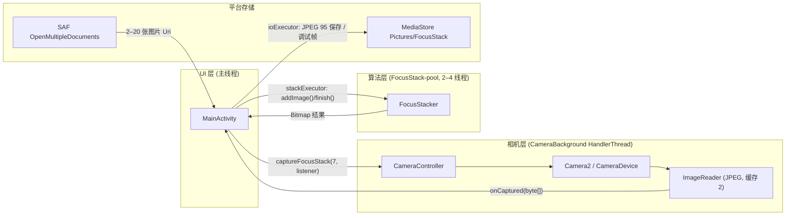
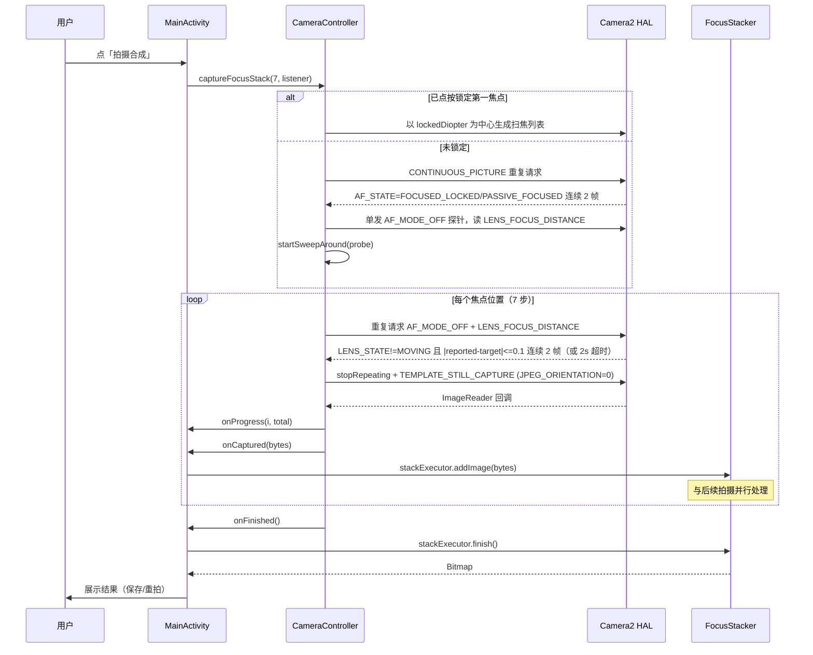
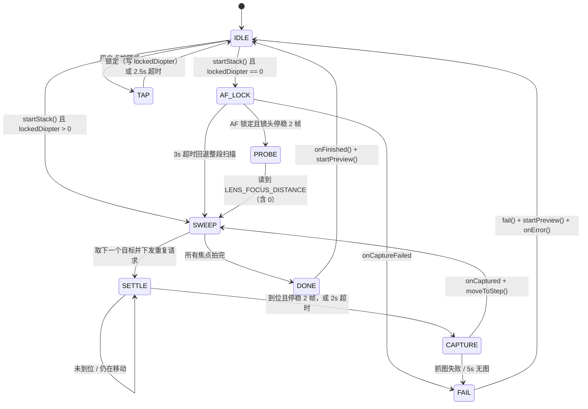
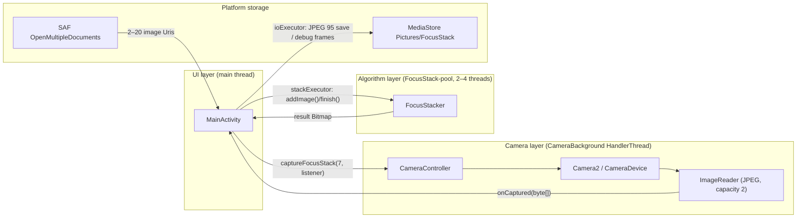
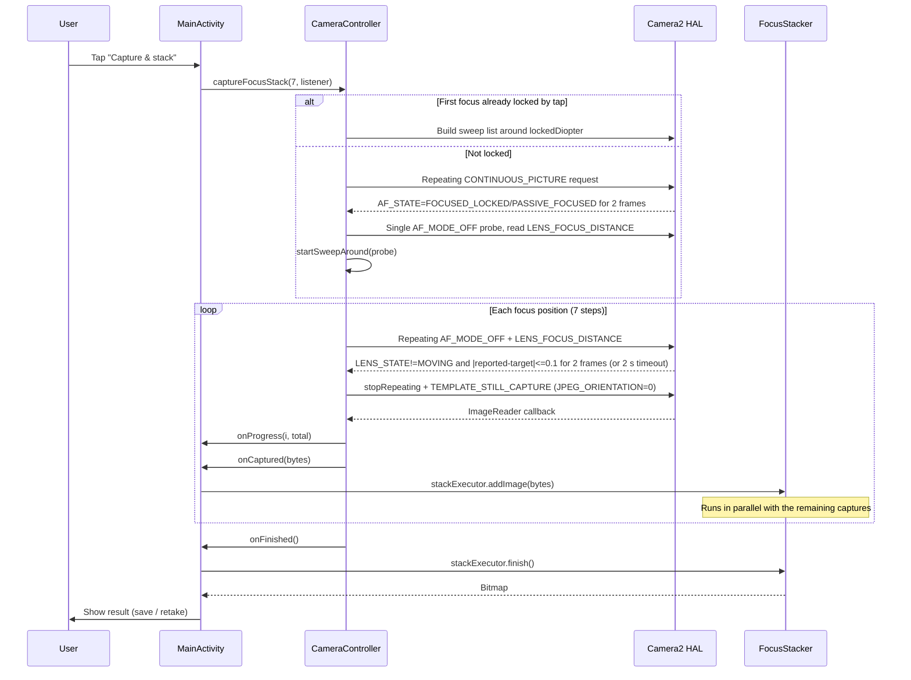
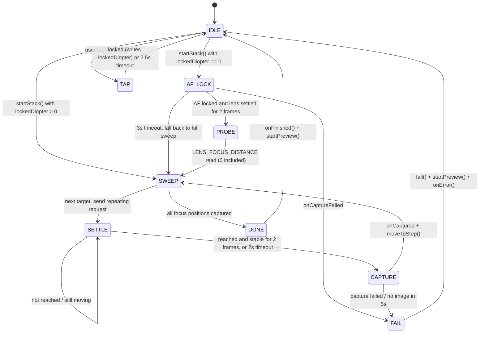

[简体中文](#简体中文) | [English](#english)

# FocusStack v2 开发者文档

> 本文档面向第一次参与本项目的贡献者，也作为架构与实现的事实参考。所有参数值、流程顺序和回调名都以当前 `app/src/main` 源码为准。如果文档与代码冲突，以代码为准，并欢迎提 PR 修正。
>
> 当前状态：核心拍摄、合成、保存流程已在作者真机上跑通（仓库 `docs/images/` 中是实际运行截图）；但仍缺少系统化测试与多机型验证，请把本文中的行为描述理解为"当前实现"，而不是"已充分验证的规格"。

## 简体中文

### 目录

1. [项目定位](#1-项目定位)
2. [技术栈与版本](#2-技术栈与版本)
3. [仓库结构](#3-仓库结构)
4. [架构分层与调用关系](#4-架构分层与调用关系)
5. [Camera2 拍摄流程](#5-camera2-拍摄流程)
6. [合成算法](#6-合成算法)
7. [相册导入模式](#7-相册导入模式)
8. [保存与权限](#8-保存与权限)
9. [参数速查表](#9-参数速查表)
10. [已知限制与技术债](#10-已知限制与技术债)
11. [开发环境搭建](#11-开发环境搭建)
12. [调试与验证](#12-调试与验证)
13. [贡献入口](#13-贡献入口)
14. [FAQ](#14-faq)
15. [参考链接](#15-参考链接)

---

### 1. 项目定位

FocusStack v2 是一个 Android 手机端的**景深合成（焦点堆叠，focus stacking）相机**。

手机镜头的景深有限：拍花蕊、昆虫、首饰、纹理这类小物件时，一次对焦无法让整个画面都清晰。这个 App 的做法是在不同对焦距离上拍多张照片，然后逐像素判断"哪张在这个位置最清晰"，把最清晰的像素融合成一张**全清晰**的图。

两种工作模式：

| 模式 | 入口 | 输入 | 张数 | 前提条件 |
| --- | --- | --- | --- | --- |
| App 内扫焦连拍 | 「拍摄合成」按钮 | Camera2 实时连拍 | 固定请求 7 张，因去重可能少于 7 张 | 后置相机 + 支持手动对焦距离（`LENS_INFO_MINIMUM_FOCUS_DISTANCE > 0`） |
| 相册导入 | 「相册合成」按钮 | SAF 多选相册照片 | 2–20 张 | 同一场景、焦点不同、拍摄时相机静止 |

当前**不在**项目范围内：几何对齐（手持重影的核心解法）、RAW/全分辨率输出、视频、多摄融合、后期调色。这些都记录在路线图里。

### 2. 技术栈与版本

| 类别 | 选型 / 版本 | 位置 |
| --- | --- | --- |
| 语言 | Kotlin 1.9.22 | `build.gradle` |
| 构建插件 | Android Gradle Plugin 8.2.2 | `build.gradle` |
| 构建工具 | Gradle 8.4（wrapper，`-bin` 分发包） | `gradle/wrapper/gradle-wrapper.properties` |
| 运行构建所需的 JDK | JDK 17 | 由 `JAVA_HOME` 指定 |
| Java/Kotlin 编译目标 | Java 8（`sourceCompatibility`/`targetCompatibility` 1.8，`jvmTarget 1.8`） | `app/build.gradle` |
| SDK | `compileSdk 34`、`targetSdk 34`、`minSdk 26` | `app/build.gradle` |
| 版本 | `versionCode 2`、`versionName "2.0"` | `app/build.gradle` |
| 包名 | `com.example.focusstack`（`namespace` 与 `applicationId` 相同） | `app/build.gradle` |
| 相机 | Camera2（`android.hardware.camera2`），未使用 CameraX | `CameraController.kt` |
| 图像 | `BitmapFactory` / `ImageDecoder` / `Bitmap` / `Matrix`，无第三方图像库 | `FocusStackProcessor.kt` |
| 存储 | MediaStore（API 29+）、旧文件 API + MediaScanner（API 26–28）、SAF 读取相册 | `MainActivity.kt` |
| UI | AppCompat 1.6.1、Material Components 1.11.0（`Theme.MaterialComponents.DayNight.NoActionBar`）、ConstraintLayout 2.1.4、core-ktx 1.12.0 | `app/build.gradle`、`res/values/themes.xml` |
| 并发 | `HandlerThread` + `ExecutorService` + 固定线程池，无协程、无 RxJava | 三个源文件 |
| 测试 | 无单元测试 / 仪器测试；本轮新增 CI 构建流水线 | `.github/workflows/android.yml` |

补充说明：

- `gradle.properties` 设置 `org.gradle.jvmargs=-Xmx2048m`、`android.useAndroidX=true`。
- Wrapper 配置里 `validateDistributionUrl=false`、`networkTimeout=10000`，`gradlew` 与 `gradle/wrapper/gradle-wrapper.jar` 都已提交，因此命令行构建不依赖本机预装 Gradle。
- `AndroidManifest.xml` 中 `largeHeap="true"`，原因见 [6.5 内存模型](#65-线程模型与内存估算)。
- 依赖只有 4 个 androidx/Material 库，没有图像处理、相机封装或网络库。

### 3. 仓库结构

只列源代码与关键配置（`build/`、`.gradle/`、`.idea/` 等产物已忽略）：

```text
FocusStack_v2/
├── build.gradle                     # 根构建脚本：Kotlin 1.9.22 + AGP 8.2.2，仓库源
├── settings.gradle                  # rootProject.name = "FocusStack"，include ':app'
├── gradle.properties                # JVM 内存、AndroidX 开关
├── gradlew / gradlew.bat            # Gradle 8.4 wrapper 启动脚本
├── gradle/wrapper/                  # wrapper jar 与 properties（Gradle 8.4）
├── build_apk.sh                     # 作者本机一键构建脚本（release/debug）
├── install_apk.sh                   # 作者本机 adb 安装脚本
├── .gitignore                       # 排除 build/、local.properties、.idea/、签名文件
├── README_使用说明.txt              # v1 遗留旧说明，内容已过期，正在被 README.md 取代
├── CONTRIBUTING.md                  # 贡献指南（中英双语，随本轮开源补全）
├── LICENSE                          # MIT
├── .github/workflows/android.yml    # CI：JDK 17 + ./gradlew assembleDebug
├── docs/
│   ├── DEVELOPMENT.md               # 本文档
│   ├── ROADMAP.md                   # 路线图与优先级
│   └── images/                      # 真机运行截图（01-preview.jpg、02-result.jpg、03-help.jpg）
└── app/
    ├── build.gradle                 # 应用模块：SDK/版本/签名配置/依赖
    └── src/main/
        ├── AndroidManifest.xml      # 权限、uses-feature、largeHeap、竖屏 Activity
        ├── java/com/example/focusstack/
        │   ├── MainActivity.kt      # UI、权限、生命周期、拍照/导入编排、保存、调试帧
        │   ├── CameraController.kt  # Camera2 封装 + 点按对焦 + 扫焦状态机
        │   └── FocusStackProcessor.kt # 合成内核，类名 FocusStacker（文件名/类名不一致是已知技术债）
        └── res/
            ├── layout/activity_main.xml   # 单页 ConstraintLayout：预览/结果/进度/底栏/帮助
            ├── drawable/focus_ring.xml    # 黄色空心对焦框
            ├── mipmap-anydpi-v26/         # 自适应图标
            └── values/                    # strings.xml（仅 app_name）、colors.xml、themes.xml
```

注意事项：

- `README_使用说明.txt` 是 v1 时期的旧文档，里面仍写着"固定 400 万像素""尚未真机验证"等过期表述，**已被当前实现推翻**，本仓库将在开源整理中删除它。请以 `README.md` 和本文档为准。
- `local.properties`、`keystore.properties`、`*.jks` 只存在于作者本机，且被 `.gitignore` 排除，**永远不要提交**。
- 所有 UI 文案目前硬编码在 Kotlin 代码与布局 XML 中，`strings.xml` 只有 `app_name`。

### 4. 架构分层与调用关系

代码是单 Activity + 三个类的直接分层，没有 ViewModel、Repository 或依赖注入：

| 层 | 类 | 职责 | 关键对外接口 |
| --- | --- | --- | --- |
| UI / 编排层 | `MainActivity` | 权限申请、生命周期、点按对焦转发、进度与结果展示、保存、相册导入、调试帧落盘 | `cameraController.captureFocusStack()`、`stacker.addImage()/finish()` |
| 相机层 | `CameraController` | Camera2 设备/会话/预览、点按对焦、自动对焦锁定、七步扫焦状态机、JPEG 取图与超时 | `StackCaptureListener` 回调：`onProgress` / `onCaptured` / `onHint` / `onFinished` / `onError` |
| 算法层 | `FocusStacker` | 流式解码、清晰度评分、加权融合、旋转输出 | `addImage(ByteArray)` / `addExternalImage(ByteArray)` / `finish(): Bitmap` |

依赖方向：`MainActivity` 依赖 `CameraController` 和 `FocusStacker`；`CameraController` **不认识** `FocusStacker`，只把 JPEG `ByteArray` 通过 `onCaptured` 交出去；`FocusStacker` 不依赖相机，只依赖 Android 的 `Bitmap` 解码 API。这样相机与算法可以各自演进、各自测试。



拍摄阶段的时序（重点看"拍摄"和"合成"如何重叠）：



### 5. Camera2 拍摄流程

全部相机操作都 post 到后台 `HandlerThread("CameraBackground")` 执行（`startBackgroundThread()` / `backgroundHandler`），主线程只做 UI。相关常量集中在 `CameraController.kt` 的 companion object 中。

#### 5.1 打开相机与预览

1. `MainActivity.onResume()` 检查 `CAMERA` 权限；没有就 `requestPermissions`，有就 `startCamera()`。
2. `startCamera()` 先 `startBackgroundThread()`，在 `TextureView` 可用时调用 `openCamera()`。`TextureView.SurfaceTextureListener.onSurfaceTextureAvailable` 也会在 Activity 已 resumed 且有权限时补一次 `startCamera()`。
3. `openCameraInternal()`（`CameraController.kt:306`）：
   - 用 `CameraManager.cameraIdList` 找 `LENS_FACING_BACK` 的后置相机，找不到回调 `onCameraError("未找到后置摄像头")`；
   - 读取 `SENSOR_ORIENTATION`（默认 90）、`LENS_INFO_MINIMUM_FOCUS_DISTANCE`（默认 0）、`SENSOR_INFO_ACTIVE_ARRAY_SIZE`；
   - 读取 `SCALER_STREAM_CONFIGURATION_MAP`，选拍照尺寸与预览尺寸；
   - 创建 `ImageReader.newInstance(captureSize, JPEG, maxImages = 2)`。
4. 尺寸选择：
   - `pickCaptureSize()`：优先 4:3（`width * 3 == height * 4`）中面积最接近 12,000,000 的；没有 4:3 就在全部尺寸里选；兜底 `Size(4000, 3000)`。
   - `pickPreviewSize()`：宽 ≤ 1920 的 4:3 尺寸里取宽度最大；否则取 ≤1920 中最大；再否则取面积最小的支持尺寸。默认值 `Size(1440, 1080)`。
5. `openCamera()` 用 `opening` 标志防止 `onOpened` 之前被重复打开；`onOpened` 里再检查 `opening`，若打开过程中已被 `close()` 则直接关掉这台相机（避免切后台后仍占用）。
6. `createPreviewSession()` 以 `[previewSurface, imageReader.surface]` 创建会话，`onConfigured` 后 `startPreview()`：`TEMPLATE_PREVIEW` + `CONTROL_AF_MODE_CONTINUOUS_PICTURE` 重复请求。

注意：本机 HAL 输出的预览缓冲已经是摆正的竖幅画面，因此代码**没有**对 `TextureView` 做 `setTransform`（`CameraController.kt:703` 附近注释）。这是对设备的隐含假设，属于已知技术债。

#### 5.2 点按对焦（记录第一焦点）

用户在预览上点一下，App 在该位置做一次自动对焦并记录镜头实际屈光度，作为后续扫焦的中心。

UI 侧（`MainActivity.kt:127`）：

- `ACTION_UP` 且 `!isCapturing` 时调用 `tapToFocus(x, y)`，记录 `lastFocusX/Y`，显示对焦框（90dp 黄框，1.6s 后自动消失），再转给 `CameraController.tapToFocus(x, y, textureView.width, textureView.height)`。
- 结果回调 `onTapFocusResult(ok)`：成功 toast「已在点击位置锁定主体焦点」；失败提示「对焦没成功，请对着有纹理的地方再点一下」。

相机侧 `doTapToFocus()`（`CameraController.kt:148`）：

1. 前置检查：会话/设备/预览面非空、`vw/vh > 0`、当前没有拍摄监听者、没有正在做自动对焦锁定，否则直接忽略。
2. 用 `viewToSensorRect()` 把视图坐标换成 `MeteringRectangle`（细节见下）。
3. 先以 `TEMPLATE_PREVIEW` + `CONTROL_AF_MODE_AUTO` + `CONTROL_AF_REGIONS`/`CONTROL_AE_REGIONS` = 该区域发起重复请求（`setRepeatingRequest`），让测光与对焦都瞄准该点。
4. 再单独 `capture()` 一发带 `CONTROL_AF_TRIGGER_START` 的请求，真正触发对焦扫描。
5. 挂 2500ms 超时 `tapFocusTimeoutRunnable`。

`viewToSensorRect()`（`CameraController.kt:226`）四步换算：

| 步骤 | 处理 | 说明 |
| --- | --- | --- |
| 1 | 归一化 | `nx = vx/vw`、`ny = vy/vh`，clamp 到 0–1 |
| 2 | 反中心裁切 | 竖幅画面（旋转后宽高比 `ah/aw`）与视图宽高比不同，预览按中心裁切铺满。用 `nx/ny` 反向补偿：`viewAspect < rotatedAspect` 时只压缩 x，反之只压缩 y |
| 3 | 反旋转 | 画面坐标 → 传感器坐标：`sensorOrientation == 90` 时 `sx=ny, sy=1-nx`；`270` 时 `sx=1-ny, sy=nx`；`180` 时两边都取反；其它不变 |
| 4 | 落到传感器像素 | `side = min(activeArray.width, activeArray.height) * 0.2`（短边 20%）；中心点为 `activeArray.left/top + (sx*aw, sy*ah)`；左/上坐标 clamp 在有效阵列内，权重 `METERING_WEIGHT_MAX` |

`tapFocusCallback`（`CameraController.kt:183`）判定"锁定成功"的条件：

- `CONTROL_AF_STATE` 是 `FOCUSED_LOCKED` 或 `NOT_FOCUSED_LOCKED`（注意：点按对焦把"对焦失败但镜头已停"也算作可用的锁定位置）；
- `LENS_STATE` 为 null 或不等于 `LENS_STATE_MOVING`；
- 以上条件**连续 2 帧**成立（`TAP_FOCUS_STABLE_FRAMES = 2`）；
- 成功后读取 `LENS_FOCUS_DISTANCE` 写入 `lockedDiopter`，回调 `onTapFocusResult(true)`。
- 2500ms 超时或 `onCaptureFailed` 则回调 `false`，不写入 `lockedDiopter`。

屈光度的含义：`LENS_FOCUS_DISTANCE` 单位是 1/米，**0 表示对焦到无限远**，数值越大表示越近。`lockedDiopter` 同时被当作"是否已锁定"的标志（`> 0` 才算已锁定），因此"点按对焦正好锁到无限远"会被当作未锁定处理——这是当前实现的一个已知小缺陷。`clearLockedFocus()` 方法存在但没有调用点；切后台 `closeInternal()` 会把 `lockedDiopter` 归零，所以重新回到前台后需要重新点按。

#### 5.3 未手动锁定时：自动对焦锁定 + 探针

`captureFocusStack(stepCount, listener)` → `startStack()`（`CameraController.kt:444`）：

1. 会话、设备为空 → `onError("相机未就绪，请稍后重试")`。
2. `minFocusDistance <= 0f` → `onError("该机型不支持手动对焦距离控制")`。
3. 保存 listener、`pendingStepCount = 7`、`stepIndex = 0`。
4. `lockedDiopter > 0` 时直接 `startSweepAround(lockedDiopter)`；否则 `lockFocusFirst()`。

`lockFocusFirst()`（`CameraController.kt:467`）：

1. 置 `afLocking = true`，`onHint("正在自动对焦锁定主体，请保持不动...")`。
2. 用 `TEMPLATE_PREVIEW` + `CONTROL_AF_MODE_CONTINUOUS_PICTURE` 发起重复请求，回调 `afLockCallback`。
3. 挂 `AF_LOCK_TIMEOUT_MS = 3000` 超时。

`afLockCallback`（`CameraController.kt:491`）：`CONTROL_AF_STATE` 为 `FOCUSED_LOCKED` **或** `PASSIVE_FOCUSED`（这里和点按对焦不同，不接受 `NOT_FOCUSED_LOCKED`），且 `LENS_STATE` 非 `MOVING`，连续 2 帧成立后：清 `afLocking`、取消超时、调用 `probeFocusDistance()`。`onCaptureFailed` 直接 `fail("对焦锁定失败")`。

`probeFocusDistance()`（`CameraController.kt:521`）：有些机型在 AF 模式下不回报屈光度，所以单独发一发 `TEMPLATE_PREVIEW` + `CONTROL_AF_MODE_OFF` 的单帧请求，在 `onCaptureCompleted` 里读取 `LENS_FOCUS_DISTANCE` 并 `startSweepAround(该值)`。如果读回 null 则按 0 处理，于是退回整段扫描。

3 秒内没有锁定成功时，`afTimeoutRunnable` 兜底调用 `startSweepAround(0f)`，保证流程一定继续（结果质量会下降，但不会卡死）。

#### 5.4 扫焦序列的生成

`startSweepAround(lockedDiopter)`（`CameraController.kt:553`）真正决定"拍哪 7 个焦点"：

```text
n     = pendingStepCount.coerceAtLeast(2)        # 默认 7
half  = (n - 1) / 2                              # 7 步时 = 3
step  = lockedDiopter * (1/4)                    # DIOPTER_STEP_FACTOR
steps = [lockedDiopter + k*step for k in -3..3]  # 升序
steps = clamp(each, 0, minFocusDistance)
steps = distinct(steps)
if steps.size < 2:
    steps = [minFocusDistance * i / (n-1) for i in 0..n-1]   # 最近→无限远均分
```

以锁定屈光度 `d` 为例，未裁剪前的 7 个值约为 `0.25d, 0.5d, 0.75d, d, 1.25d, 1.5d, 1.75d`——对应距离约 `0.57×D` 到 `4×D`（`D` 为主体对焦距离），即从"比主体远约 4 倍"到"比主体近约一半"。升序排列意味着拍摄顺序是**远 → 近**（0 屈光度是无限远）。

两种回退：

- 锁定值 ≤ 0（没锁定成功、或探针读到 0）或步数为奇数且 `half == 0`：均匀扫描 `0 → minFocusDistance`，共 n 步。
- `distinct()` 后不足 2 个位置：同样回退为均匀扫描。

重要后果：`clamp` 与 `distinct` 都可能让实际列表**少于 7 张**（例如主体本来就很近或很远）。UI 的进度显示用的是 `onProgress(index, total)` 里的实际 `total`（`MainActivity.kt:284` 显示"正在拍摄第 ${index+1}/$total 张"），因此不会出现"永远卡在 7 张"的问题。

#### 5.5 每个焦点：移动镜头 → 等到位 → 抓图

`moveToStep()`（`CameraController.kt:572`）：

1. `stepIndex >= focusSteps.size` → `finishStack()`。
2. 先回调 `listener.onProgress(stepIndex, focusSteps.size)`（0 基下标）。
3. `waitingForSettle = true`、`settleStableCount = 0`。
4. 发起**重复请求**：`TEMPLATE_PREVIEW` + `CONTROL_AF_MODE_OFF` + `CONTROL_LENS_FOCUS_DISTANCE = focusSteps[stepIndex]`，回调 `focusCallback`。
5. 挂 `SETTLE_TIMEOUT_MS = 2000` 超时 `settleTimeoutRunnable`。

`focusCallback`（`CameraController.kt:601`）判定"镜头到位"：

- `reported = LENS_FOCUS_DISTANCE`；`reached = reported == null || |reported - target| <= 0.1`（`FOCUS_TOLERANCE`，reported 为 null 时视为到位）；
- `LENS_STATE` 为 null 或不是 `MOVING`；
- 连续 2 帧（`SETTLE_STABLE_FRAMES`）成立 → `triggerStillCapture()`；
- 2 秒超时也会兜底触发拍摄（可能未完全到位，但保证流程前进）。

`triggerStillCapture()`（`CameraController.kt:627`）：

1. 防重入：`waitingForSettle` 为 false 直接返回；置 false 并移除 settle 超时。
2. `session.stopRepeating()` 停止预览重复请求。
3. 发起 `TEMPLATE_STILL_CAPTURE`，target 为 `imageReader.surface`，参数：`CONTROL_AF_MODE_OFF`、`CONTROL_LENS_FOCUS_DISTANCE = 该步目标值`、`JPEG_ORIENTATION = 0`（旋转统一留到合成后做，避免每张旋转方向不一致）。
4. 挂 `IMAGE_TIMEOUT_MS = 5000` 的 `imageTimeoutRunnable`，5 秒拿不到图就 `fail("第 N 张图像数据超时")`。
5. `stopRepeating()` 在会话已关闭时可能抛 `IllegalStateException`，外层 `catch (e: Exception)` 兜底为 `fail("拍摄请求失败：...")`。

#### 5.6 从 ImageReader 取流式 JPEG

`onImageCaptured(image)`（`CameraController.kt:665`）：

1. 移除图像超时回调；
2. `image.planes[0].buffer` 拷进 `ByteArray`，**先读出数据再 `image.close()`**（这是 commit `42c56ba` 修掉的严重 bug：不读数据直接关，合成必然拿不到像素）；
3. `listener == null`（已失败/取消）则丢弃；
4. `stepIndex++`，调用 `listener.onCaptured(bytes)`；
5. 紧接着 `moveToStep()` 拍下一张。

`MainActivity` 的 `onCaptured`（`MainActivity.kt:293`）**立刻**把数据分派出去，不攒在内存：

- `debugKeepFrames` 为 true 时，先在 `ioExecutor` 保存调试原图；
- 在 `stackExecutor`（单线程）里 `stacker.addImage(jpeg)`，保证同一次拍摄的图片按序进入融合；`OutOfMemoryError` / 异常会走 `cancelFlow(...)` 复位界面。

因此"拍第 N+1 张"和"合成第 N 张"是并行发生的，ImageReader 只缓存 2 张且用 `acquireLatestImage()`，不会积压。

全部步骤拍完后 `finishStack()`（`CameraController.kt:678`）：清空 listener、`startPreview()` 恢复预览、回调 `onFinished()`。`MainActivity` 再在 `stackExecutor` 里执行 `stacker.finish()`，回到主线程 `showResult(bitmap)`。

#### 5.7 失败、取消、超时与生命周期

| 触发 | 代码路径 | 行为 |
| --- | --- | --- |
| 用户点「取消拍摄」 | `cancelStack()` → 后台线程 `fail("拍摄已取消")` | 仅当 `listener != null` 时中断，恢复预览并回调 `onError` |
| 切后台 / 锁屏 | `onPause()` → `close()` → `closeInternal()` | `listener?.onError("拍摄已取消")`，关闭 session/device/reader/surface，`lockedDiopter = 0`，随后 `stopBackgroundThread()` |
| 某步 2s 未稳定 | `settleTimeoutRunnable` | 照常抓图（可能略虚） |
| 抓图后 5s 没图 | `imageTimeoutRunnable` | `fail("第 N 张图像数据超时")` |
| 拍摄请求/预览失败 | `onCaptureFailed` | `fail("第 N 张拍摄失败")` / `fail("对焦预览失败")` |
| 自动对焦 3s 未锁定 | `afTimeoutRunnable` | 回退整段扫描，不报错 |
| 点按对焦 2.5s 未锁定 | `tapFocusTimeoutRunnable` | `onTapFocusResult(false)`，不写入锁定值 |
| 相机断开 | `onDisconnected` | 关闭设备并置空，**不提示用户**（已知缺陷） |

`fail(message)`（`CameraController.kt:685`）是统一收尾：复位 `waitingForSettle`/`afLocking`，移除 settle/image/af 三个定时回调，先 `startPreview()` 再回调 `listener.onError(message)`；若此时没有 listener（相机级错误），改走 `onCameraError`。

生命周期要点：

- `onPause` 释放相机，`onResume` 重新打开；相机权限被拒时 `finish()` 退出。
- `onDestroy` 里 `stackExecutor.shutdownNow()`、`ioExecutor.shutdownNow()`，任务提交用 `executeQuietly` 包住 `RejectedExecutionException`。
- Activity 固定竖屏（Manifest `screenOrientation="portrait"`），避免旋转重建把拍摄流程打断。
- 拍摄/合成过程中底部"拍摄合成 / 相册合成"按钮禁用，避免重复触发。

#### 5.8 扫焦状态机



#### 5.9 CameraController 关键参数

| 常量 | 值 | 含义 |
| --- | --- | --- |
| `CAPTURE_TARGET_AREA` | `12_000_000` | 目标拍照像素数，实际选 4:3 中面积最接近的尺寸 |
| `PREVIEW_MAX_WIDTH` | `1920` | 预览宽度上限 |
| `SETTLE_TIMEOUT_MS` | `2000` | 每个焦点等待镜头到位的最长时间，超时也抓图 |
| `SETTLE_STABLE_FRAMES` | `2` | 到位需连续满足的帧数 |
| `FOCUS_TOLERANCE` | `0.1` | `\|reported - target\|` 容差（屈光度） |
| `IMAGE_TIMEOUT_MS` | `5000` | 抓图后等 JPEG 数据到达的超时 |
| `AF_LOCK_TIMEOUT_MS` | `3000` | 自动对焦锁定超时，超时回退整段扫描 |
| `TAP_FOCUS_TIMEOUT_MS` | `2500` | 点按对焦锁定超时 |
| `TAP_FOCUS_STABLE_FRAMES` | `2` | 点按对焦锁定需连续满足的帧数 |
| `TAP_FOCUS_REGION_FRACTION` | `0.2` | 对焦/测光矩形边长 = 传感器短边 × 20% |
| `DIOPTER_STEP_FACTOR` | `1/4` | 扫焦步长 = 锁定屈光度 / 4 |
| `FOCUS_STEP_COUNT`（MainActivity） | `7` | 请求拍摄张数 |
| `MAX_IMPORT_IMAGES`（MainActivity） | `20` | 相册导入上限 |
| 默认预览尺寸 | `1440 × 1080` | 打开相机前/无支持列表时的兜底 |
| 默认拍照尺寸 | `4000 × 3000` | 同上 |
| ImageReader `maxImages` | `2` | 配合 `acquireLatestImage()` 防积压 |

### 6. 合成算法

算法内核在 `FocusStackProcessor.kt`，类名 `FocusStacker`（文件名与类名不一致，见技术债）。

#### 6.1 流式处理模型

每张 JPEG 到达后**立即**处理，而不是等全部拍完：

1. 降采样解码（`inSampleSize = 2`，或用 `ImageDecoder.setTargetSampleSize(2)`），面积变为 1/4：4000×3000 → 2000×1500（约 3MP）；解码出的 `Bitmap` 用完立刻 `recycle()`。
2. 第一张照片决定工作尺寸 `width × height`；后续照片尺寸不同则 `Bitmap.createScaledBitmap` 等比缩放到工作尺寸（不会丢弃）。
3. 每张只保留"一张工作图 + 累加器"，不保留历史帧的像素。
4. `finish()` 把累加器归一化成最终 `Bitmap`。

这样内存峰值与照片张数无关，且拍摄与合成可以流水线并行。

#### 6.2 数学流程

对第 `i` 张工作图（`W×H`，ARGB）：

```text
# 1) 灰度（BT.601 加权），结果存 ByteArray，0–255
gray(x,y) = (299*R + 587*G + 114*B) / 1000
          # toByte() 后高位截断为负数，读取时 & 0xFF 还原

# 2) 拉普拉斯边缘强度（4 邻域，取绝对值；图像边界置 0）
lap(x,y) = |4*gray(x,y) - gray(x-1,y) - gray(x+1,y) - gray(x,y-1) - gray(x,y+1)|
score(x,y) = lap(x,y)

# 3) 清晰度平滑：先横向箱式模糊，再纵向箱式模糊，半径 R=3
#    用滚动求和，复杂度 O(W*H)；边界按实际窗口长度取平均

# 4) 该帧的清晰度基准 = 平滑后得分的均值（采样 1/128 估计），下限 1
basis = max(mean(score), 1)

# 5) 逐像素权重：清晰度相对基准的 12 次方，+1 保证最低权重
w(x,y) = 1 + (score(x,y) / basis)^12

# 6) 通道增益：把本帧每个通道的均值对齐到第一帧（同一把尺子比亮度/白平衡）
gain[c] = refMeans[c] / mean[c]     # 仅当 mean[c] > 1，否则 1

# 7) 流式累加
weightT(x,y) += w
sum[c](x,y)  += clamp(pixel[c] * gain[c], 0, 255) * w

# 8) finish()：归一化 + 四舍五入 + clamp，写回 ARGB
out(x,y) = clamp(round(sum[c](x,y) / max(weightT(x,y), 1e-6)), 0, 255)
```

实现细节：

- 灰度只算一次并缓存为 `ByteArray`，拉普拉斯不再每像素重复算 5 次灰度。
- 箱式模糊用滚动求和：每行/每列初始化一次窗口和，之后"加右减左"，复杂度从 O(w·h·r) 降为 O(w·h)。
- `basis` 用 `meanOf()` 每 128 个像素采样一次（`FocusStackProcessor.kt:274`），足够稳定且快。
- 通道均值同样每 128 像素采样（`channelMeans()`，`FocusStackProcessor.kt:254`），避免 3MP 全量遍历。
- `finish()` 的除零保护下限是 `1e-6`；`rotateDegrees % 360 == 0` 时直接返回，否则用 `Matrix.postRotate` + 双线性插值旋转一次（相机模式传入 `sensorOrientation`，相册导入传 0）。

#### 6.3 设计取舍（为什么这么做）

**为什么用加权融合，而不是"选最清晰的一张"？**
虚化区域并非真正均匀：传感器噪声、JPEG 压缩会在虚化背景里产生随机彩噪，而"选最大值"很容易把某张的噪声误判成清晰像素，结果出现彩色斑点和硬接缝。加权融合下，没有细节的区域各帧 `score/basis ≈ 1`、权重都 ≈1，等于把多张**平均**，噪声互相抵消、虚化过渡自然；只有在真正有边缘的位置，最清晰那帧的权重大幅领先。代价是需要保留累加器（内存），以及各帧轻微错位会被平均成更复杂的重影（见限制章节）。

**为什么用均值归一化，而不是分位数？**
清晰度分数的量纲随画面整体对比度变化：同一场景曝光/白平衡不同，`score` 整体会缩放。如果拿每帧的 95 分位或一个全局固定基准去比，等于用不同的尺子量不同照片：分位数对"少量高对比边缘"特别敏感，会把细节多的帧基准抬高，导致权重系统性偏低。用"该帧自身的平均清晰度"做基准，正好抵消整体缩放，使不同帧的 `score/basis` 可以互相比较。（早期版本用过「逐帧分位数 + 累积全局基准」的组合，这是**错误的**：先处理的帧基准偏小、权重被放大几十倍，会把虚化帧的像素压过后面清晰帧，成片整块发软，已废弃。）

**十二次方的意义？**
权重曲线 `1 + r^12` 是一个软选择：`r = 1`（该帧平均水平）权重 2，`r = 2` 权重 4096，`r = 3` 权重 531441——最清晰帧会以数量级压制其它帧，避免虚化帧"渗"进结果造成发软；`r < 1` 的区域权重都趋近 1，退化为平均。指数越大选择越"硬"（接缝风险越大），越小越平滑（可能略软）。指数必须足够陡：白纸小字这类低对比度主体，清晰帧的得分往往只比虚化帧高 1～2 倍，指数太小（实测 4～6）会让虚化帧按比例混进来，整块发软。`SMOOTH_RADIUS` 与指数是调节清晰度/自然度的主要旋钮。

**为什么不用「逐像素挑最清晰的一张」（argmax）？**
单从清晰度看，argmax 甚至略好于加权融合，但它对本项目有一个致命问题：手机镜头在变焦时**视场角会变**（呼吸效应）。实测同一场景在最近与最远对焦之间，画面中心位移约 0，而边缘可达 35 像素（工作分辨率下约 1% 的尺度变化）。逐像素硬挑会在高对比度边缘、以及"没有真正对上焦但边缘很强"的区域，把来自不同帧、位置略有差异的边缘拼在一起，撕出可见的锯齿状白斑。加权融合的过渡是连续的，天然没有这种拼接痕迹，代价是在低对比度区域略微偏软。要真正用好 argmax，需要先做几何对齐（见路线图）。

**增益对齐解决什么？**
连拍过程中 HAL 可能重新测光、调整白平衡，导致不同帧整体亮度或色温有差异。若不补偿，逐像素选帧会在画面里留下斑块状的亮度/色彩跳变。按通道均值比例把每帧对齐到第一帧，相当于做了一次粗粒度的亮度/白平衡统一，代价很小。

#### 6.4 并行与线程模型

`FocusStacker` 内部使用一个**静态**固定线程池（companion object 里的 `pool`）：

- `THREAD_COUNT = availableProcessors().coerceIn(2, 4)`，线程名 `FocusStack-pool`，`isDaemon = true`；
- `parallelRows(h) { y0, y1 -> ... }`（`FocusStackProcessor.kt:323`）：当 `h < MIN_PARALLEL_ROWS(256)` 时直接串行执行；否则按行切成 `THREAD_COUNT` 段，提交到池里并 `Future.get()` 等待，工作线程异常通过 `ExecutionException.cause` 重新抛出。
- 灰度、拉普拉斯、两向模糊、权重合并、`finish()` 归一化全部走 `parallelRows`。
- 注意：纵向模糊按行分块时，每个线程会各自初始化自己块顶部 `[y0-r, y0+r]` 的窗口和，因此是重复计算而非结果不一致。

外层还有三个执行器（`MainActivity`）：

| 执行器 | 线程数 | 职责 |
| --- | --- | --- |
| 主线程 | 1 | UI、点按、进度、结果展示 |
| `HandlerThread("CameraBackground")` | 1 | 所有 Camera2 操作、定时器、ImageReader 回调 |
| `stackExecutor` | 1 | 串行执行 `addImage()` / `finish()`，保证顺序、防重复触发 |
| `ioExecutor` | 1 | 保存相册、保存调试帧，避免在 UI 线程压缩/写盘 |

`stackExecutor` 单线程是关键：`onCaptured` 来自相机后台线程，如果并发调用 `addImage`，累加器会出现竞态；单线程排队还天然保证 `finish()` 在最后一张之后执行。

#### 6.5 线程模型与内存估算

工作尺寸为 2000×1500（3,000,000 像素）时的常驻数组：

| 数组 | 类型 | 大小（约） |
| --- | --- | --- |
| `pixels`（当前工作图 ARGB） | `IntArray` | 12 MB |
| `gray`（灰度） | `ByteArray` | 3 MB |
| `score`、`tmp`（清晰度/模糊中间） | `FloatArray × 2` | 24 MB |
| `sumR`、`sumG`、`sumB`、`weightT`（累加器） | `FloatArray × 4` | 48 MB |
| 合计（8 个同尺寸数组） | | **约 87 MB**（按 4 B/像素上界估算约 96 MB） |

再算上输出阶段：`finish()` 里的 `out: IntArray` 约 12 MB、`Bitmap.createBitmap` 再复制一份约 12 MB；相机模式还要 `Matrix` 旋转出第二张 Bitmap（约 12 MB）。峰值接近 120–130 MB，这就是 Manifest 必须开 `largeHeap="true"` 的原因。解码时每张原图也会短暂占用一份 Bitmap（约 12 MB，`inSampleSize=2` 后），但 `consume()` 里立刻 `recycle()`。

降低内存的方向（未实现）：把 `sumR/G/B` 合并、用半精度/量化、按条带分块合成、直接输出更低工作分辨率。相册导入模式下工作尺寸由第一张照片决定，如果导入 48MP 原图，降采样后仍有 12MP 工作尺寸，内存会成倍增加——目前没有上限保护。

### 7. 相册导入模式

入口：`btnPickPhotos` → `pickImagesLauncher.launch(arrayOf("image/*"))`，使用 `ActivityResultContracts.OpenMultipleDocuments()`（SAF，**不需要存储权限**）。

`startStackFromUris(uris)`（`MainActivity.kt:337`）：

1. `isCapturing` 时直接忽略。
2. `uris.take(MAX_IMPORT_IMAGES = 20)`；不足 2 张 → toast「至少选择 2 张照片」并 return；超过 20 张 → toast 提示只用前 20 张。
3. 置 `isCapturing = true`、禁用按钮、显示进度「正在读取照片 1/N...」。
4. `FocusStacker(0)`：因为导入照片的方向由解码器负责摆正，合成后不再旋转。
5. 在 `stackExecutor` 里逐张 `readUriBytes(uri)`（`contentResolver.openInputStream(uri).readBytes()`）：
   - 读取异常返回 null，**跳过该张**，继续下一张；
   - `stacker.addExternalImage(bytes)`：API 28+ 用 `ImageDecoder`（`setTargetSampleSize(2)`、`ALLOCATOR_SOFTWARE`、`isMutableRequired = false`），会自动应用 EXIF 方向；API 26–27 回退 `BitmapFactory`（**不处理 EXIF**，见限制）；
   - 每张更新进度「正在合成第 i/N 张...」；
   - `OutOfMemoryError` → `failAndReset("内存不足，请减少照片数量或关闭其他应用后重试")`。
6. 结束后若成功读取的 `ok < 2` → `failAndReset("至少需要 2 张可正常读取的照片")`。
7. `stacker.finish()` → `showResult(result)`。

与相机模式的区别：

| 项目 | 相机模式 | 相册导入 |
| --- | --- | --- |
| 相机是否运行 | 是，拍完恢复预览 | 否，预览保持原样（被进度层遮住） |
| 旋转 | `FocusStacker(sensorOrientation)`，`finish()` 旋转 | `FocusStacker(0)`，`ImageDecoder` 已摆正 |
| 张数 | 请求 7，实际可能更少 | 2–20，实际可能因读取失败更少 |
| 失败语义 | 任一相机步骤失败即整体失败 | 单张读取失败跳过，可读 < 2 才失败 |
| 内存风险 | 工作尺寸固定约 3MP | 工作尺寸由第一张决定，高像素照片风险高 |

### 8. 保存与权限

保存入口 `btnSave` → `saveResult()`（`MainActivity.kt:483`）：

1. `lastResultBitmap` 为空或 `isSaving` 为真 → 直接返回（防重复保存）。
2. `SDK < 29` 且没有 `WRITE_EXTERNAL_STORAGE` → 申请权限并 return；授权后 toast「已授权，请再点一次保存」，需要用户再点一次。
3. 置 `isSaving = true`、禁用保存按钮，按系统版本分派到 `ioExecutor`。

两条保存路径：

| | Android 10（API 29）及以上 | Android 9（API 28）及以下 |
| --- | --- | --- |
| API | `MediaStore.Images.Media.insert` + `openOutputStream` | `File(Environment.getExternalStoragePublicDirectory(PICTURES), "FocusStack")` + `FileOutputStream` |
| 位置 | `Pictures/FocusStack`（`RELATIVE_PATH`） | `Pictures/FocusStack`（真实目录） |
| 半张图保护 | `IS_PENDING = 1` 写入，完成后置 0 | 不适用 |
| 相册可见 | 解除 pending 后自动可见 | `MediaScannerConnection.scanFile(...)` 通知扫描 |
| 权限 | 无需存储权限 | 运行时 `WRITE_EXTERNAL_STORAGE`（Manifest 里 `maxSdkVersion=28`） |
| 文件名 | `FocusStack_<System.currentTimeMillis()>.jpg` | 同名规则 |
| 压缩 | JPEG quality 95 | JPEG quality 95 |
| 失败处理 | 删除已插入的 Uri，toast「保存失败」 | toast「保存失败：...」 |

成功后 `returnToPreviewSoon()`：`window.decorView.postDelayed(..., 800)` 回到预览，方便连续拍下一张；`finishSaving()` 在成功/失败后都恢复按钮。保存中产生的 `showToast` 都会 `runOnUiThread`。

权限矩阵：

| 能力 | 权限 / 机制 | 声明位置 | 申请时机 | 拒绝后果 |
| --- | --- | --- | --- | --- |
| 相机预览与拍摄 | `android.permission.CAMERA` | Manifest | `onResume` 时 | toast 后 `finish()` 退出 |
| 相册导入 | SAF（`OpenMultipleDocuments`） | 无需声明 | 用户点按钮时 | 无（系统选择器自行处理） |
| Android 10+ 保存 | MediaStore，无需权限 | — | — | — |
| Android 9- 保存 | `WRITE_EXTERNAL_STORAGE`（`maxSdkVersion="28"`） | Manifest | 点保存时 | toast「需要存储权限才能保存照片」 |
| 相机硬件 | `uses-feature camera.back`（必需）、`camera.level.full`（非必需） | Manifest | 安装时由商店过滤 | — |

调试期注意：`MainActivity.debugKeepFrames` 当前硬编码为 `true`（`MainActivity.kt:411`），每拍一张都会把原图另存到 `Pictures/FocusStack/_debug/frame_N.jpg`（走 MediaStore，API 29+ 带 `IS_PENDING` 保护）。这会额外占用存储并保留未经用户确认的原图，属于隐私/存储问题；正式发布前应改为 `false` 或 `BuildConfig.DEBUG`。相册导入模式不会保存调试帧。

### 9. 参数速查表

`CameraController`（companion object）：

| 常量 | 值 | 说明 |
| --- | --- | --- |
| `CAPTURE_TARGET_AREA` | `12_000_000` | 目标约 12MP，选 4:3 最接近的 |
| `PREVIEW_MAX_WIDTH` | `1920` | 预览宽度上限 |
| `SETTLE_TIMEOUT_MS` | `2000` | 镜头到位等待上限 |
| `SETTLE_STABLE_FRAMES` | `2` | 到位连续帧数 |
| `FOCUS_TOLERANCE` | `0.1` | 屈光度到位容差 |
| `IMAGE_TIMEOUT_MS` | `5000` | 等 JPEG 数据超时 |
| `AF_LOCK_TIMEOUT_MS` | `3000` | 自动对焦锁定超时 |
| `TAP_FOCUS_TIMEOUT_MS` | `2500` | 点按对焦超时 |
| `TAP_FOCUS_STABLE_FRAMES` | `2` | 点按锁定连续帧数 |
| `TAP_FOCUS_REGION_FRACTION` | `0.2` | 对焦区域 = 传感器短边 20% |
| `DIOPTER_STEP_FACTOR` | `0.25` | 扫焦步长 = 锁定值 × 1/4 |

`FocusStacker`：

| 常量 | 值 | 说明 |
| --- | --- | --- |
| `WORK_SAMPLE_SIZE` | `2` | 解码降采样倍数（面积 1/4，约 3MP） |
| `SMOOTH_RADIUS` | `3` | 清晰度分数箱式模糊半径 |
| `MIN_PARALLEL_ROWS` | `256` | 行数低于此值不并行 |
| `THREAD_COUNT` | `availableProcessors().coerceIn(2, 4)` | 图像处理线程数 |
| `WEIGHT_GAMMA` | `12f` | 融合权重指数（越大越接近"只挑最清晰那张"） |

`MainActivity` / UI：

| 常量 / 行为 | 值 | 说明 |
| --- | --- | --- |
| `FOCUS_STEP_COUNT` | `7` | 请求连拍张数 |
| `MAX_IMPORT_IMAGES` | `20` | 相册导入上限 |
| `debugKeepFrames` | `true` | 保存每张调试原图（发布前应关闭） |
| 保存后回预览 | `800 ms` | `returnToPreviewSoon()` |
| 保存 JPEG 质量 | `95` | 两条保存路径一致 |
| 对焦框显示时长 | `1500 / 1600 ms` | 回调 toast 与框自动隐藏 |

构建 / Manifest：

| 配置 | 值 | 位置 |
| --- | --- | --- |
| `minSdk` / `targetSdk` / `compileSdk` | 26 / 34 / 34 | `app/build.gradle` |
| `versionCode` / `versionName` | 2 / "2.0" | `app/build.gradle` |
| `largeHeap` | `true` | `AndroidManifest.xml` |
| 屏幕方向 | `portrait` | `AndroidManifest.xml` |
| Gradle | 8.4（wrapper） | `gradle/wrapper/gradle-wrapper.properties` |
| JDK | 17 | `JAVA_HOME` |

### 10. 已知限制与技术债

按影响排序，方便挑选贡献方向：

1. **没有几何对齐（最大质量瓶颈）**。算法假设多张照片像素位置完全重合；手持或脚架微动/风导致画面移动时，结果会出现重影、边缘发虚。当前只能靠"稳定支架 + 静止主体 + 充足光线"规避。路线图第一优先级是特征对齐（例如 ECC/光流/角点 + 单应矩阵）。
2. **输出只有约 3MP（2000×1500）**，不是 12MP 全分辨率。原因是流式融合的工作图被 `inSampleSize=2` 降采样，且内存需要 8 个同尺寸数组。全分辨率需要分块（tile）合成与更严格的内存预算。
3. **强依赖机型手动对焦支持**。要求 `LENS_INFO_MINIMUM_FOCUS_DISTANCE > 0`；部分机型不支持或无该特性，会直接提示「该机型不支持手动对焦距离控制」。不同机型的对焦范围、步长响应、`LENS_FOCUS_DISTANCE` 回报精度都不同，尚未做机型适配/标定。
4. **扫焦范围是固定比例假设**（以锁定屈光度 × 1/4 为步长、±3 步），对超近或超远主体可能覆盖不足，且 `clamp` + `distinct` 会让实际张数少于 7。
5. **预览方向依赖设备 HAL**：代码假设预览缓冲已摆正、不做 `setTransform`；在方向行为不同的机型上预览可能拉伸或方向错误。
6. **相册导入的工作尺寸没有上限**。第一张决定尺寸，导入 48MP 照片时工作尺寸仍可能达 12MP，内存成倍上升，存在 OOM 风险。
7. **Android 8.x（API 26–27）导入照片不处理 EXIF 方向**：`ImageDecoder` 需要 API 28+，低版本回退 `BitmapFactory` 不会自动旋转，结果方向可能不对。
8. **UI 全部硬编码中文**，`strings.xml` 只有 `app_name`，没有英文字符串资源，也没有国际化/深色模式专项适配（主题是 DayNight，但颜色写死为黑底）。
9. **`debugKeepFrames` 默认为 `true`**，会把每次拍摄的原图写到 `Pictures/FocusStack/_debug`，涉及隐私与存储，发布前必须处理。
10. **文件/类名不一致**：`FocusStackProcessor.kt` 里定义的类是 `FocusStacker`；`CameraController.clearLockedFocus()` 无调用点。
11. **没有单元测试 / 仪器测试 / lint 基线**；CI 本轮才补上（`.github/workflows/android.yml` 只做 JDK 17 + `./gradlew assembleDebug`，不上传签名包），测试仍缺失。
12. **构建脚本不可移植**：`build_apk.sh` 硬编码 `~/android-toolchain/jdk-17*`、`~/Library/Android/sdk`、`~/android-toolchain/gradle-8.4/bin/gradle`；`install_apk.sh` 硬编码 `~/Library/Android/sdk/platform-tools/adb`。只适合作者本机，其他贡献者请用 Android Studio 或 `./gradlew`。
13. **release 签名依赖本地文件**：`keystore.properties` 与 `*.jks` 被 `.gitignore` 排除；没有配置时 `assembleRelease` 产出的是未签名 APK，而 `build_apk.sh` 打印的是 `app-release.apk` 路径，会指错文件。
14. **无 EXIF/元数据写入**，输出没有方向标签、没有拍摄参数；除合成后的旋转外无任何后期处理。
15. **相机断开无用户提示**（`onDisconnected` 只释放资源），表现为预览静止。
16. **单 Activity、无状态保存**：切后台会取消拍摄并清空 `lockedDiopter`；`applicationId` 仍是 `com.example.focusstack`，正式发布前需替换。

诚实状态说明：上述功能的核心链路（点按对焦、7 步扫焦、加权融合、保存）已在作者真机上跑通，并留下 `docs/images/` 截图；但**没有**系统化测试、没有多机型验证、没有长时间稳定性验证。请不要把本文当作"质量已验证"的背书。

### 11. 开发环境搭建

#### 前置条件

- JDK 17（AGP 8.2 要求；Android Studio 自带 JBR 17 也可以）。
- Android SDK Platform 34 + Build-Tools。
- 一台 Android 8.0（API 26）以上的**真机**（模拟器通常没有可用的手动对焦），并支持手动对焦距离（`LENS_INFO_MINIMUM_FOCUS_DISTANCE > 0`）。
- 端口/网络：Gradle 首次构建需要下载依赖（google、mavenCentral）。

#### 方式 A：Android Studio（推荐给普通贡献者）

1. Android Studio（Hedgehog 2023.1.1 或更新，支持 AGP 8.2）→ `Open` → 选择仓库根目录。
2. 等待 Gradle Sync；如果提示 SDK 缺失，按提示安装 API 34。
3. 手机开启开发者选项 + USB 调试，连接电脑并允许调试。
4. 选择 `app` 配置 → `Run`。
5. 首次启动会请求相机权限；拒绝会退出 App。

#### 方式 B：命令行 Gradle

```bash
export JAVA_HOME=/path/to/jdk-17          # macOS 示例：/Library/Java/JavaVirtualMachines/jdk-17.jdk/Contents/Home
# 二选一：写 local.properties，或导出 ANDROID_HOME
echo "sdk.dir=/path/to/Android/sdk" > local.properties
export ANDROID_HOME=/path/to/Android/sdk

./gradlew assembleDebug                   # 产出 app/build/outputs/apk/debug/app-debug.apk
./gradlew installDebug                    # 直接安装到已连接设备
./gradlew lint                            # 可选，当前没有基线
```

`gradlew` 会自动下载 Gradle 8.4（wrapper）；`local.properties` 被 `.gitignore` 排除，不要提交。

#### 方式 C：作者本机脚本（仅适合作者环境）

`./build_apk.sh [debug|release]`：

- 默认 `release`；`./build_apk.sh debug` 打调试包。
- 从 `~/android-toolchain/jdk-17*` 找 JDK，`JAVA_HOME` 指向其 `Contents/Home`（macOS 解压版布局）。
- `ANDROID_HOME=~/Library/Android/sdk`。
- 用 `~/android-toolchain/gradle-8.4/bin/gradle`（不是 `./gradlew`）执行 `assembleDebug` / `assembleRelease`。
- release 需要根目录的 `keystore.properties`（字段：`storeFile`、`storePassword`、`keyAlias`、`keyPassword`）和对应 `.jks`；文件不存在时构建退化为未签名。
- 脚本最后打印的 APK 路径固定为 `app/build/outputs/apk/release/app-release.apk`，无签名时实际文件名不同。

`./install_apk.sh`：

- adb 固定为 `~/Library/Android/sdk/platform-tools/adb`。
- 优先安装 `app/build/outputs/apk/release/app-release.apk`，不存在则用 debug 包。
- 检查设备列表，没有设备时打印开启 USB 调试的步骤并退出。
- `adb install -r`；签名冲突时提示先 `adb uninstall com.example.focusstack`。

#### 签名说明

- 普通贡献者用 debug 构建即可，不需要任何签名配置。
- 不要提交：`keystore.properties`、`*.jks`、`*.keystore`、`local.properties`、`build/`、`.gradle/`、`.idea/`（`.gitignore` 已覆盖）。
- 发布者/维护者本地创建 `keystore.properties`（被忽略）并放置 `.jks`；`app/build.gradle` 会读取它并用于 `release` 签名。仓库里出现的 `focusstack-release.jks` 属于作者本地文件，不应进入版本库。
- CI 只构建 debug 包，不接触签名材料。

### 12. 调试与验证

#### logcat tag

| Tag | 来源 | 关键日志 |
| --- | --- | --- |
| `MainActivity` | `MainActivity.kt` | `SurfaceTexture 就绪 尺寸=...`、`SurfaceTexture 尺寸变化`、保存/读取照片失败 |
| `CameraController` | `CameraController.kt` | `预览尺寸选定：...`、`点按对焦：view=... region=...`、`点按对焦锁定：屈光度=...`、`使用已锁定的第一焦点：屈光度=...`、`扫焦序列（屈光度）=[...]`、拍摄/对焦失败原因 |
| `FocusStacker` | `FocusStackProcessor.kt` | `解码失败`、`外部照片解码失败` |

```bash
adb logcat -s MainActivity:D CameraController:D FocusStacker:D
```

#### 画质调试建议

调试融合效果时，最有用的做法是**把连拍原图和合成结果都取出来，用同一块区域做客观对比**，而不是只看成片"感觉"：

1. 临时在 `onCaptured(jpeg)` 里把每张 JPEG 存到 `Pictures/FocusStack/_debug/frame_<序号>.jpg`（用 `MediaStore`，和保存结果同样的写法），拍一次后 `adb pull /sdcard/Pictures/FocusStack/_debug`；
2. 在电脑上用 Pillow/numpy 复现 `mergeOneImage()` 的流程，试不同 `WEIGHT_GAMMA` / `SMOOTH_RADIUS`，用**区域梯度能量**（`|Δx| + |Δy|` 的均值）量化清晰度；
3. 关键指标是「合成结果 / 该区域最清晰单帧」的比值，正常应 ≥ 1.0（因为不同区域来自不同帧，可以超过 1）；**比值 < 0.9 的块**就是融合没挑对的地方。
4. 注意梯度能量会被噪声/拼接痕迹抬高，量化指标必须配合肉眼检查裁剪图，否则容易把"斑点很多"误判成"很清晰"。

> 历史教训：曾用「逐帧分位数 + 累积全局基准」做归一化，客观指标看起来正常，成片却整块发软——因为先处理的帧权重被放大。**上线前一定要用真机原图做同场景对比验证。**

#### 手工验证建议

拍摄路径：

1. 手机固定在桌面/三脚架，主体（花、小物件、纹理卡片）也固定，光线充足。
2. 打开 App → 点按主体上纹理丰富的区域，确认 toast「已在点击位置锁定主体焦点」、`logcat` 出现 `点按对焦锁定：屈光度=...`。
3. 点「拍摄合成」，保持手机静止；观察进度条张数、`logcat` 的「扫焦序列」是否为 7 个升序屈光度。
4. 结果页检查：合焦区域是否比单张更全清晰、有没有重影/彩色斑块；点「保存到相册」后 `Pictures/FocusStack` 是否出现图片。
5. 点「重拍」回预览；测试「取消拍摄」：拍摄中点取消应回到预览且不崩。
6. 切后台再回前台：相机应自动重开（`lockedDiopter` 会被清零，需要重新点按）。

导入路径：

1. 在稳定环境下用相机或已有素材准备 2–20 张同场景、不同焦点的照片。
2. 点「相册合成」→ 多选；少于 2 张应提示；超过 20 张只取前 20 张。
3. 观察进度文案；结果与拍摄路径一致。可混入 1 张无法读取的文件验证"跳过失败、继续合成"。

回归检查清单（提交 PR 前建议过一遍）：

- [ ] `./gradlew assembleDebug` 通过；
- [ ] 拍摄 7 步流程能完成并出图（或明确解释少于 7 张）；
- [ ] 相册导入 2 张、20 张、含 1 张坏图三种情况；
- [ ] 保存路径在 API 29+ 与 API 26–28 设备上各验证一次（或说明未验证）；
- [ ] 拍摄中取消 / 切后台 / 连续快速点击按钮不崩；
- [ ] 权限拒绝（相机 / 存储）有合理提示。

### 13. 贡献入口

- 先读 [CONTRIBUTING.md](CONTRIBUTING.md)（分支模型、提交信息、PR 流程、代码风格）。
- 路线图与优先级见 [docs/ROADMAP.md](docs/ROADMAP.md)。
- 项目概览与使用说明见 [README.md](README.md)。
- Issue 模板与 PR 模板在 `.github/`；CI 在 `.github/workflows/android.yml`，PR 会自动跑 `assembleDebug`。

适合新人上手的任务：

| 类型 | 示例 | 涉及位置 |
| --- | --- | --- |
| 文档 | 修正本文与代码不一致处、补充设备兼容性记录、翻译 | `docs/`、`README.md` |
| i18n | 把硬编码中文字符串迁到 `strings.xml`，补 `values-en/` | `MainActivity.kt`、`res/layout/activity_main.xml`、`res/values/strings.xml` |
| 测试 | 抽离纯函数（灰度/拉普拉斯/权重）做 JVM 单元测试 | `FocusStackProcessor.kt` |
| UI | 进度/结果页布局、深色模式、按钮状态 | `res/layout/`、`MainActivity.kt` |
| 兼容性 | 收集机型 `LENS_INFO_MINIMUM_FOCUS_DISTANCE`、对焦范围与结果样本 | 提 Issue 附 logcat |
| 构建 | 让 `build_apk.sh` / `install_apk.sh` 可移植（优先 `./gradlew`、`ANDROID_HOME`） | 两个 shell 脚本 |

开始阅读代码的推荐顺序：`MainActivity.startCaptureStack()` → `CameraController.startStack()` → `CameraController.startSweepAround()` → `FocusStacker.mergeOneImage()` → `FocusStacker.finish()`。

提交前请确保：不引入新的第三方依赖（尤其图像/相机库）除非在 Issue 中讨论过；相机操作保持在后台线程；不提交签名文件与本机路径配置；修改参数时同步更新本文档。

### 14. FAQ

**Q1：为什么合成结果发虚 / 有重影？**
最常见原因是多张照片之间**没有几何对齐**：手持拍摄、风、或脚架轻微移动会让像素错位，融合后表现为重影和边缘发虚。其次是光线不足（快门变慢、噪点增大）、主体超出扫焦范围（太近/太远的区域本来就没对上焦）、或点按对焦没有锁在主体上。改善：固定手机与主体、增强光线、点按主体纹理处对焦后再拍。

**Q2：为什么输出只有约 300 万像素，而不是 1200 万？**
为手机内存与稳定性做的取舍：融合需要 8 个同尺寸数组，2000×1500 时已约 87 MB，12MP 会到约 350 MB，必然 OOM。要输出全分辨率需要分块合成（tile）与更复杂的内存管理，目前未实现。

**Q3：为什么有些手机提示「该机型不支持手动对焦距离控制」？**
因为 `LENS_INFO_MINIMUM_FOCUS_DISTANCE` 为 0，说明该机型/该后摄不暴露手动对焦距离控制，App 的扫焦方式无法工作。可在 Issue 里附上机型与 `adb shell dumpsys media.camera` 的信息。

**Q4：合成失败或闪退怎么办？**
先看 `adb logcat -s MainActivity:D CameraController:D FocusStacker:D`：`照片解码失败` 通常是个别照片损坏；`内存不足` 是 OOM（减少导入张数/降低照片分辨率）；`第 N 张图像数据超时` 是相机卡住。闪退多发生在导入高像素照片或张数很多时，属于已知内存限制。

**Q5：为什么保存后相册里没有立刻出现？**
API 29+ 用 `IS_PENDING` 保护，写入完成后才解除；部分相册 App 有缓存，需要下拉刷新。Android 9- 依赖 `MediaScannerConnection` 扫描，个别机型扫描较慢。若一直不出现，确认保存路径 `Pictures/FocusStack` 且有存储权限。

**Q6：如何改对焦步数 / 清晰度平滑半径？**
- 连拍张数：`MainActivity.FOCUS_STEP_COUNT`（当前 7），同时看 `CameraController.startSweepAround()` 里的 `half` 与 `DIOPTER_STEP_FACTOR`（当前 1/4）。
- 平滑半径：`FocusStacker.SMOOTH_RADIUS`（当前 3），调大更平滑但会削弱局部选择。
- 选择强度：`mergeOneImage()` 里的 `weight = 1 + r^12`，把指数调大更"硬"（更锐利但更易接缝），调小更柔和。
- 输出分辨率：`WORK_SAMPLE_SIZE`（当前 2），改成 1 是全分辨率但内存约 4 倍，风险很高。

**Q7：为什么说拍 7 张，实际只看到 5 张？**
`startSweepAround()` 会对扫焦列表做 `clamp` 到 `[0, minFocusDistance]` 并 `distinct()`，主体很近/很远或锁定值太小时会产生重复值，实际张数因此变少；进度文案显示的是实际 `total`，属于预期行为。

**Q8：点按对焦后切到后台再回来，焦点为什么没了？**
`onPause` 会 `close()` 释放相机，`closeInternal()` 把 `lockedDiopter` 归零。回到前台需要重新点按；如果只是短暂切后台，可考虑后续优化为保存锁定值（路线图待办）。

**Q9：相册导入的照片方向不对？**
API 28+ 用 `ImageDecoder` 自动应用 EXIF 方向；Android 8.x（API 26–27）回退 `BitmapFactory`，不处理 EXIF，可能方向错误。可先在相册里另存/旋转摆正后再导入，或等后续补 EXIF 处理。

### 15. 参考链接

- Android Camera2 概览：<https://developer.android.com/media/camera/camera2>
- Camera2 拍摄会话与请求：<https://developer.android.com/reference/android/hardware/camera2/CameraCaptureSession>
- `CameraCharacteristics`（`LENS_INFO_MINIMUM_FOCUS_DISTANCE`、`SENSOR_ORIENTATION` 等）：<https://developer.android.com/reference/android/hardware/camera2/CameraCharacteristics>
- `CaptureRequest` / `CaptureResult`（`LENS_FOCUS_DISTANCE`、`LENS_STATE`、`CONTROL_AF_STATE`）：<https://developer.android.com/reference/android/hardware/camera2/CaptureRequest>
- `ImageReader`：<https://developer.android.com/reference/android/media/ImageReader>
- `ImageDecoder`：<https://developer.android.com/reference/android/graphics/ImageDecoder>
- MediaStore 与共享存储：<https://developer.android.com/training/data-storage/shared/media>
- Storage Access Framework（`OpenMultipleDocuments`）：<https://developer.android.com/guide/topics/providers/document-provider>
- 焦点堆叠原理：<https://en.wikipedia.org/wiki/Focus_stacking>
- 拉普拉斯算子（离散）：<https://en.wikipedia.org/wiki/Discrete_Laplace_operator>
- 箱式模糊：<https://en.wikipedia.org/wiki/Box_blur>
- BT.601 亮度权重：<https://en.wikipedia.org/wiki/Rec._601>

---

## English

### Table of Contents

1. [Project Overview](#1-project-overview)
2. [Tech Stack and Versions](#2-tech-stack-and-versions)
3. [Repository Layout](#3-repository-layout)
4. [Architecture and Call Flow](#4-architecture-and-call-flow)
5. [Camera2 Capture Pipeline](#5-camera2-capture-pipeline)
6. [The Stacking Algorithm](#6-the-stacking-algorithm)
7. [Gallery Import Mode](#7-gallery-import-mode)
8. [Saving and Permissions](#8-saving-and-permissions)
9. [Constants Quick Reference](#9-constants-quick-reference)
10. [Known Limitations and Technical Debt](#10-known-limitations-and-technical-debt)
11. [Development Setup](#11-development-setup)
12. [Debugging and Verification](#12-debugging-and-verification)
13. [Contributing](#13-contributing)
14. [Frequently Asked Questions (FAQ)](#14-frequently-asked-questions-faq)
15. [References](#15-references)

---

### 1. Project Overview

FocusStack v2 is an Android **focus-stacking camera**. A phone lens has limited depth of field, so small subjects such as flower stamens, insects, jewellery, or textured surfaces cannot be captured sharp end to end in a single shot. The app takes several photos at different focus distances and then, per pixel, decides which frame is sharpest there and fuses those pixels into one **all-in-focus** image.

Two operating modes:

| Mode | Entry point | Input | Frame count | Requirements |
| --- | --- | --- | --- | --- |
| In-app focus sweep | "Capture & stack" button | Live Camera2 burst | Requests 7; may be fewer after deduplication | Rear camera with manual focus distance support (`LENS_INFO_MINIMUM_FOCUS_DISTANCE > 0`) |
| Gallery import | "Stack from gallery" button | SAF multi-select | 2–20 | Same scene, different focus positions, static camera |

Out of scope today: geometric alignment (the main fix for handheld ghosting), RAW/full-resolution output, video, multi-camera fusion, and colour grading. These are tracked in the roadmap.

### 2. Tech Stack and Versions

| Category | Choice / version | Location |
| --- | --- | --- |
| Language | Kotlin 1.9.22 | `build.gradle` |
| Build plugin | Android Gradle Plugin 8.2.2 | `build.gradle` |
| Build tool | Gradle 8.4 (wrapper, `-bin` distribution) | `gradle/wrapper/gradle-wrapper.properties` |
| Build JDK | JDK 17 | via `JAVA_HOME` |
| Java/Kotlin targets | Java 8 (`sourceCompatibility`/`targetCompatibility` 1.8, `jvmTarget 1.8`) | `app/build.gradle` |
| SDK levels | `compileSdk 34`, `targetSdk 34`, `minSdk 26` | `app/build.gradle` |
| Version | `versionCode 2`, `versionName "2.0"` | `app/build.gradle` |
| Package | `com.example.focusstack` (`namespace` and `applicationId`) | `app/build.gradle` |
| Camera | Camera2 (`android.hardware.camera2`), no CameraX | `CameraController.kt` |
| Imaging | `BitmapFactory` / `ImageDecoder` / `Bitmap` / `Matrix`; no third-party imaging library | `FocusStackProcessor.kt` |
| Storage | MediaStore (API 29+), legacy file API + MediaScanner (API 26–28), SAF for gallery reads | `MainActivity.kt` |
| UI | AppCompat 1.6.1, Material Components 1.11.0 (`Theme.MaterialComponents.DayNight.NoActionBar`), ConstraintLayout 2.1.4, core-ktx 1.12.0 | `app/build.gradle`, `res/values/themes.xml` |
| Concurrency | `HandlerThread` + `ExecutorService` + fixed thread pool; no coroutines, no RxJava | three source files |
| Tests | No unit or instrumentation tests; a CI build workflow is being added in this round | `.github/workflows/android.yml` |

Additional notes:

- `gradle.properties` sets `org.gradle.jvmargs=-Xmx2048m` and `android.useAndroidX=true`.
- The wrapper uses `validateDistributionUrl=false` and `networkTimeout=10000`. Both `gradlew` and `gradle/wrapper/gradle-wrapper.jar` are committed, so command-line builds do not depend on a locally installed Gradle.
- `AndroidManifest.xml` enables `largeHeap="true"`; see [6.5 Threading and Memory Model](#65-threading-and-memory-model) for why.
- There are only four androidx/Material dependencies — no imaging, camera-wrapper, or networking libraries.

### 3. Repository Layout

Source and key configuration only (`build/`, `.gradle/`, `.idea/` and other artifacts are ignored):

```text
FocusStack_v2/
├── build.gradle                     # Root build: Kotlin 1.9.22 + AGP 8.2.2, repositories
├── settings.gradle                  # rootProject.name = "FocusStack", include ':app'
├── gradle.properties                # JVM heap, AndroidX flag
├── gradlew / gradlew.bat            # Gradle 8.4 wrapper scripts
├── gradle/wrapper/                  # Wrapper jar + properties (Gradle 8.4)
├── build_apk.sh                     # Author-local one-command build (release/debug)
├── install_apk.sh                   # Author-local adb install helper
├── .gitignore                       # Ignores build/, local.properties, .idea/, signing files
├── README_使用说明.txt              # Legacy v1 notes, outdated, being replaced by README.md
├── CONTRIBUTING.md                  # Contribution guide (bilingual, added in this round)
├── LICENSE                          # MIT
├── .github/workflows/android.yml    # CI: JDK 17 + ./gradlew assembleDebug
├── docs/
│   ├── DEVELOPMENT.md               # This document
│   ├── ROADMAP.md                   # Roadmap and priorities
│   └── images/                      # Real-device screenshots (01-preview.jpg, 02-result.jpg, 03-help.jpg)
└── app/
    ├── build.gradle                 # App module: SDK levels, version, signing, dependencies
    └── src/main/
        ├── AndroidManifest.xml      # Permissions, uses-feature, largeHeap, portrait activity
        ├── java/com/example/focusstack/
        │   ├── MainActivity.kt      # UI, permissions, lifecycle, capture/import orchestration, saving, debug frames
        │   ├── CameraController.kt  # Camera2 wrapper + tap-to-focus + focus-sweep state machine
        │   └── FocusStackProcessor.kt # Stacking kernel; the class is FocusStacker (filename/class mismatch is known debt)
        └── res/
            ├── layout/activity_main.xml   # Single ConstraintLayout page: preview/result/progress/bottom bar/help
            ├── drawable/focus_ring.xml    # Yellow hollow focus ring
            ├── mipmap-anydpi-v26/         # Adaptive icon
            └── values/                    # strings.xml (only app_name), colors.xml, themes.xml
```

Caveats:

- `README_使用说明.txt` is a v1-era document that still claims "fixed 4 MP output" and "not yet verified on a real device". Both statements are **outdated**; it will be removed during the open-source cleanup. Treat `README.md` and this document as the source of truth.
- `local.properties`, `keystore.properties`, and `*.jks` exist only on the author's machine and are excluded by `.gitignore`. **Never commit them.**
- All UI strings are currently hard-coded in Kotlin and layout XML; `strings.xml` contains only `app_name`.

### 4. Architecture and Call Flow

The code is a single Activity plus three directly layered classes, with no ViewModel, repository, or dependency injection:

| Layer | Class | Responsibility | Key API surface |
| --- | --- | --- | --- |
| UI / orchestration | `MainActivity` | Permissions, lifecycle, tap-to-focus forwarding, progress and result display, saving, gallery import, debug frame persistence | `cameraController.captureFocusStack()`, `stacker.addImage()/finish()` |
| Camera | `CameraController` | Camera2 device/session/preview, tap-to-focus, AF lock, 7-step focus-sweep state machine, JPEG retrieval and timeouts | `StackCaptureListener`: `onProgress` / `onCaptured` / `onHint` / `onFinished` / `onError` |
| Algorithm | `FocusStacker` | Streaming decode, sharpness scoring, weighted fusion, rotated output | `addImage(ByteArray)` / `addExternalImage(ByteArray)` / `finish(): Bitmap` |

Dependency direction: `MainActivity` depends on `CameraController` and `FocusStacker`; `CameraController` does **not** know about `FocusStacker` — it only hands `ByteArray` JPEGs out through `onCaptured`; `FocusStacker` has no camera dependency, only Android bitmap decoding. This keeps camera code and algorithm code independently evolvable and testable.



Capture sequence (note how capture and stacking overlap):



### 5. Camera2 Capture Pipeline

Every camera operation is posted to a background `HandlerThread("CameraBackground")` (see `startBackgroundThread()` / `backgroundHandler`); the main thread only touches UI. The relevant constants live in the companion object of `CameraController.kt`.

#### 5.1 Opening the camera and starting preview

1. `MainActivity.onResume()` checks `CAMERA` permission. If missing, it calls `requestPermissions`; otherwise it calls `startCamera()`.
2. `startCamera()` starts the background thread and calls `openCamera()` when the `TextureView` is available. `TextureView.SurfaceTextureListener.onSurfaceTextureAvailable` also triggers `startCamera()` when the Activity is resumed and permission is granted.
3. `openCameraInternal()` (`CameraController.kt:306`):
   - Finds a back-facing camera via `CameraManager.cameraIdList` (`LENS_FACING_BACK`); if none, reports `onCameraError("未找到后置摄像头")`.
   - Reads `SENSOR_ORIENTATION` (default 90), `LENS_INFO_MINIMUM_FOCUS_DISTANCE` (default 0), and `SENSOR_INFO_ACTIVE_ARRAY_SIZE`.
   - Reads `SCALER_STREAM_CONFIGURATION_MAP` and selects capture and preview sizes.
   - Creates an `ImageReader.newInstance(captureSize, JPEG, maxImages = 2)`.
4. Size selection:
   - `pickCaptureSize()`: prefer 4:3 sizes (`width * 3 == height * 4`) whose area is closest to 12,000,000; otherwise any size; fallback `Size(4000, 3000)`.
   - `pickPreviewSize()`: prefer 4:3 sizes ≤1920 wide, picking the widest; otherwise the widest ≤1920; otherwise the smallest supported size. Default `Size(1440, 1080)`.
5. `openCamera()` uses an `opening` flag so it cannot be entered twice before `onOpened`. `onOpened` re-checks `opening` and closes the device immediately if `close()` was called while opening (for example, the app went to background).
6. `createPreviewSession()` creates the session with `[previewSurface, imageReader.surface]`; `onConfigured` calls `startPreview()`: a repeating `TEMPLATE_PREVIEW` request with `CONTROL_AF_MODE_CONTINUOUS_PICTURE`.

Note: on the author's device the HAL already delivers an upright portrait preview buffer, so the code deliberately does **not** call `setTransform` on the `TextureView` (see the comment near `CameraController.kt:703`). This is a device-specific assumption and is listed as technical debt.

#### 5.2 Tap-to-focus (establishing the first focal point)

When the user taps the preview, the app focuses at that point and records the lens's actual dioptre, which becomes the centre of the later sweep.

UI side (`MainActivity.kt:127`):

- On `ACTION_UP` while `!isCapturing`, `tapToFocus(x, y)` records `lastFocusX/Y`, shows the focus ring (90 dp yellow box, auto-hidden after 1.6 s), and forwards to `CameraController.tapToFocus(x, y, textureView.width, textureView.height)`.
- `onTapFocusResult(ok)` toasts "Focus locked at the tapped position" on success, or "Focus failed — tap on a textured area and try again" on failure.

Camera side, `doTapToFocus()` (`CameraController.kt:148`):

1. Guards: session/device/preview surface must be non-null, `vw/vh > 0`, no active stack listener, and no AF lock in progress; otherwise the tap is ignored.
2. Converts the tapped point into a `MeteringRectangle` with `viewToSensorRect()` (four steps below).
3. Fires a repeating `TEMPLATE_PREVIEW` request with `CONTROL_AF_MODE_AUTO` and `CONTROL_AF_REGIONS`/`CONTROL_AE_REGIONS` set to the rect, so metering and focus both target the tap.
4. Sends one extra `capture()` with `CONTROL_AF_TRIGGER_START` to actually start the AF scan.
5. Arms a 2500 ms timeout (`tapFocusTimeoutRunnable`).

`viewToSensorRect()` (`CameraController.kt:226`) in four steps:

| Step | Operation | Details |
| --- | --- | --- |
| 1 | Normalize | `nx = vx/vw`, `ny = vy/vh`, clamped to 0–1 |
| 2 | Undo centre crop | The portrait frame (rotated aspect `ah/aw`) and the view have different aspect ratios, so preview is centre-cropped. Compensate: when `viewAspect < rotatedAspect`, squeeze x only; otherwise squeeze y only |
| 3 | Undo rotation | Frame → sensor coordinates: for `sensorOrientation == 90`, `sx=ny, sy=1-nx`; for `270`, `sx=1-ny, sy=nx`; for `180`, invert both; otherwise unchanged |
| 4 | Map to sensor pixels | `side = min(activeArray.width, activeArray.height) * 0.2` (20 % of the short side); centre is `activeArray.left/top + (sx*aw, sy*ah)`; left/top clamped to the active array; weight `METERING_WEIGHT_MAX` |

`tapFocusCallback` (`CameraController.kt:183`) considers the focus locked when:

- `CONTROL_AF_STATE` is `FOCUSED_LOCKED` or `NOT_FOCUSED_LOCKED` (note: for tap focus, "failed but lens stopped" is still a usable focal position);
- `LENS_STATE` is null or not `LENS_STATE_MOVING`;
- Both hold for **2 consecutive frames** (`TAP_FOCUS_STABLE_FRAMES = 2`);
- Then `LENS_FOCUS_DISTANCE` is stored in `lockedDiopter` and `onTapFocusResult(true)` fires.
- A 2500 ms timeout or `onCaptureFailed` reports `false` and does not set `lockedDiopter`.

Dioptre semantics: `LENS_FOCUS_DISTANCE` is in 1/metre, **0 means infinity**, and larger values mean closer. `lockedDiopter` doubles as the "is locked" flag (`> 0`), so tapping a subject at infinity is treated as "not locked" — a known minor defect. `clearLockedFocus()` exists but is never called; `closeInternal()` resets `lockedDiopter` to 0, so the lock is lost after backgrounding.

#### 5.3 Without a manual lock: autofocus lock + probe

`captureFocusStack(stepCount, listener)` → `startStack()` (`CameraController.kt:444`):

1. Null session/device → `onError("相机未就绪，请稍后重试")`.
2. `minFocusDistance <= 0f` → `onError("该机型不支持手动对焦距离控制")`.
3. Stores the listener, sets `pendingStepCount = 7` and `stepIndex = 0`.
4. `lockedDiopter > 0` → `startSweepAround(lockedDiopter)` directly; otherwise `lockFocusFirst()`.

`lockFocusFirst()` (`CameraController.kt:467`):

1. Sets `afLocking = true`, calls `onHint("正在自动对焦锁定主体，请保持不动...")`.
2. Starts a repeating `TEMPLATE_PREVIEW` request with `CONTROL_AF_MODE_CONTINUOUS_PICTURE`, callback `afLockCallback`.
3. Arms `AF_LOCK_TIMEOUT_MS = 3000`.

`afLockCallback` (`CameraController.kt:491`): accepts `CONTROL_AF_STATE` equal to `FOCUSED_LOCKED` **or** `PASSIVE_FOCUSED` (unlike tap focus, `NOT_FOCUSED_LOCKED` is not accepted here) and `LENS_STATE != MOVING`, for 2 consecutive frames. On success it clears `afLocking`, cancels the timeout, and calls `probeFocusDistance()`. `onCaptureFailed` calls `fail("对焦锁定失败")`.

`probeFocusDistance()` (`CameraController.kt:521`): some devices do not report the dioptre while in AF mode, so it sends a single `TEMPLATE_PREVIEW` frame with `CONTROL_AF_MODE_OFF` and reads `LENS_FOCUS_DISTANCE` in `onCaptureCompleted`, then calls `startSweepAround(value)`. A null read is treated as 0, which falls back to a full-range sweep.

If the lock does not succeed within 3 s, `afTimeoutRunnable` calls `startSweepAround(0f)` so the flow always continues (quality degrades, but it cannot hang).

#### 5.4 Building the focus sweep

`startSweepAround(lockedDiopter)` (`CameraController.kt:553`) decides which focus positions are captured:

```text
n     = pendingStepCount.coerceAtLeast(2)        # 7 by default
half  = (n - 1) / 2                              # 3 for n = 7
step  = lockedDiopter * (1/4)                    # DIOPTER_STEP_FACTOR
steps = [lockedDiopter + k*step for k in -3..3]  # ascending
steps = clamp(each, 0, minFocusDistance)
steps = distinct(steps)
if steps.size < 2:
    steps = [minFocusDistance * i / (n-1) for i in 0..n-1]   # closest → infinity, evenly spaced
```

For a locked dioptre `d`, the seven raw values are approximately `0.25d, 0.5d, 0.75d, d, 1.25d, 1.5d, 1.75d` — corresponding to distances of roughly `0.57×D` to `4×D` (where `D` is the subject distance), i.e. from about four times farther than the subject down to roughly half the subject distance. Ascending order means the capture order is **far → near** (0 dioptre is infinity).

Two fallbacks:

- Locked value ≤ 0 (lock failed, or probe read 0), or `half == 0`: sweep uniformly from `0` to `minFocusDistance` in `n` steps.
- Fewer than 2 distinct positions after `distinct()`: same uniform fallback.

Important consequence: `clamp` and `distinct` can make the actual list **shorter than 7** (for example, a very close or very distant subject). The UI progress uses the real `total` from `onProgress(index, total)` (`MainActivity.kt:284` shows "Capturing frame ${index+1}/$total"), so it never gets stuck expecting 7.

#### 5.5 Each focus step: move the lens, wait for settle, capture

`moveToStep()` (`CameraController.kt:572`):

1. `stepIndex >= focusSteps.size` → `finishStack()`.
2. Fires `listener.onProgress(stepIndex, focusSteps.size)` (zero-based index).
3. Sets `waitingForSettle = true`, `settleStableCount = 0`.
4. Sends a **repeating** request: `TEMPLATE_PREVIEW` + `CONTROL_AF_MODE_OFF` + `CONTROL_LENS_FOCUS_DISTANCE = focusSteps[stepIndex]`, callback `focusCallback`.
5. Arms the `SETTLE_TIMEOUT_MS = 2000` timeout (`settleTimeoutRunnable`).

`focusCallback` (`CameraController.kt:601`) decides the lens has arrived when:

- `reported = LENS_FOCUS_DISTANCE`; `reached = reported == null || |reported - target| <= 0.1` (`FOCUS_TOLERANCE`; a null report counts as reached);
- `LENS_STATE` is null or not `MOVING`;
- Both hold for 2 consecutive frames (`SETTLE_STABLE_FRAMES`) → `triggerStillCapture()`;
- The 2 s timeout also forces a capture (possibly not fully settled, but the flow advances).

`triggerStillCapture()` (`CameraController.kt:627`):

1. Re-entry guard: returns if `waitingForSettle` is false; otherwise clears it and removes the settle timeout.
2. `session.stopRepeating()` to stop the preview request.
3. Sends `TEMPLATE_STILL_CAPTURE` targeting `imageReader.surface` with `CONTROL_AF_MODE_OFF`, `CONTROL_LENS_FOCUS_DISTANCE = target`, and `JPEG_ORIENTATION = 0` (rotation is deferred until after stacking so all frames share the same orientation).
4. Arms `IMAGE_TIMEOUT_MS = 5000` (`imageTimeoutRunnable`); if no image arrives, `fail("第 N 张图像数据超时")`.
5. `stopRepeating()` can throw `IllegalStateException` if the session is already closed; the outer `catch (e: Exception)` converts that into `fail("拍摄请求失败：...")`.

#### 5.6 Streaming JPEGs out of ImageReader

`onImageCaptured(image)` (`CameraController.kt:665`):

1. Removes the image timeout callback;
2. Copies `image.planes[0].buffer` into a `ByteArray`, **then** calls `image.close()` (commit `42c56ba` fixed a serious bug where the buffer was never read and stacking therefore always failed);
3. Drops the frame if `listener == null` (failed/cancelled);
4. Increments `stepIndex`, calls `listener.onCaptured(bytes)`;
5. Calls `moveToStep()` for the next frame.

`MainActivity.onCaptured` (`MainActivity.kt:293`) dispatches the bytes **immediately**, never accumulating:

- If `debugKeepFrames` is true, saves the raw frame on `ioExecutor`;
- Posts `stacker.addImage(jpeg)` to the single-threaded `stackExecutor`, preserving capture order; `OutOfMemoryError` and other exceptions go through `cancelFlow(...)` to reset the UI.

As a result, "capture frame N+1" and "stack frame N" run concurrently. ImageReader holds at most 2 images and uses `acquireLatestImage()` to avoid backlogs.

After the last step, `finishStack()` (`CameraController.kt:678`) clears the listener, calls `startPreview()` to restore preview, and fires `onFinished()`. `MainActivity` then runs `stacker.finish()` on `stackExecutor` and shows the result on the main thread via `showResult(bitmap)`.

#### 5.7 Failures, cancellation, timeouts and lifecycle

| Trigger | Code path | Behaviour |
| --- | --- | --- |
| User taps "Cancel capture" | `cancelStack()` → background `fail("拍摄已取消")` | Aborts only when `listener != null`, restores preview, fires `onError` |
| App backgrounded / screen locked | `onPause()` → `close()` → `closeInternal()` | `listener?.onError("拍摄已取消")`, closes session/device/reader/surface, sets `lockedDiopter = 0`, then `stopBackgroundThread()` |
| A step does not settle in 2 s | `settleTimeoutRunnable` | Captures anyway (possibly slightly soft) |
| No JPEG 5 s after capture request | `imageTimeoutRunnable` | `fail("第 N 张图像数据超时")` |
| Capture/preview request fails | `onCaptureFailed` | `fail("第 N 张拍摄失败")` / `fail("对焦预览失败")` |
| AF lock not achieved in 3 s | `afTimeoutRunnable` | Falls back to a full-range sweep, no error |
| Tap focus not locked in 2.5 s | `tapFocusTimeoutRunnable` | `onTapFocusResult(false)`, `lockedDiopter` unchanged |
| Camera disconnected | `onDisconnected` | Closes and nulls the device, **no user message** (known defect) |

`fail(message)` (`CameraController.kt:685`) is the common teardown: resets `waitingForSettle`/`afLocking`, removes the settle/image/AF callbacks, calls `startPreview()` first, then invokes `listener.onError(message)`. If there is no listener (camera-level error), it calls `onCameraError` instead.

Lifecycle notes:

- `onPause` releases the camera; `onResume` reopens it. A denied camera permission calls `finish()`.
- `onDestroy` calls `stackExecutor.shutdownNow()` and `ioExecutor.shutdownNow()`; task submission is wrapped by `executeQuietly` to swallow `RejectedExecutionException`.
- The Activity is locked to portrait (`screenOrientation="portrait"`), avoiding configuration-change rebuilds during capture.
- The "Capture & stack" / "Stack from gallery" buttons are disabled while capturing or stacking to prevent re-entry.

#### 5.8 Focus-sweep state machine



#### 5.9 CameraController constants

| Constant | Value | Meaning |
| --- | --- | --- |
| `CAPTURE_TARGET_AREA` | `12_000_000` | Target capture pixel count; picks the closest 4:3 size |
| `PREVIEW_MAX_WIDTH` | `1920` | Preview width limit |
| `SETTLE_TIMEOUT_MS` | `2000` | Max wait per focus position; captures anyway on timeout |
| `SETTLE_STABLE_FRAMES` | `2` | Consecutive frames required for "settled" |
| `FOCUS_TOLERANCE` | `0.1` | `\|reported - target\|` tolerance (dioptre) |
| `IMAGE_TIMEOUT_MS` | `5000` | Max wait for JPEG data after a capture |
| `AF_LOCK_TIMEOUT_MS` | `3000` | AF lock timeout; falls back to full sweep |
| `TAP_FOCUS_TIMEOUT_MS` | `2500` | Tap-to-focus lock timeout |
| `TAP_FOCUS_STABLE_FRAMES` | `2` | Consecutive frames required for tap lock |
| `TAP_FOCUS_REGION_FRACTION` | `0.2` | Focus/metering square = 20 % of sensor short side |
| `DIOPTER_STEP_FACTOR` | `1/4` | Sweep step = locked dioptre / 4 |
| `FOCUS_STEP_COUNT` (MainActivity) | `7` | Requested frame count |
| `MAX_IMPORT_IMAGES` (MainActivity) | `20` | Gallery import limit |
| Default preview size | `1440 × 1080` | Fallback before/without a supported list |
| Default capture size | `4000 × 3000` | Same |
| ImageReader `maxImages` | `2` | Used with `acquireLatestImage()` to prevent backlog |

### 6. The Stacking Algorithm

The kernel lives in `FocusStackProcessor.kt`; the class is named `FocusStacker` (filename/class mismatch is known debt).

#### 6.1 Streaming model

Each JPEG is processed **immediately**, rather than after the whole burst:

1. Downsample on decode (`inSampleSize = 2`, or `ImageDecoder.setTargetSampleSize(2)`); area drops to 1/4: 4000×3000 → 2000×1500 (about 3 MP). The decoded `Bitmap` is `recycle()`d immediately after use.
2. The first photo fixes the working size `width × height`; later photos of a different size are scaled with `Bitmap.createScaledBitmap` (never discarded).
3. Only "one working image + accumulators" is retained; previous frames' pixels are never kept.
4. `finish()` normalises the accumulators into the final `Bitmap`.

Peak memory is therefore independent of frame count, and capture and stacking can pipeline.

#### 6.2 The math

For the `i`-th working image (`W×H`, ARGB):

```text
# 1) Grayscale (BT.601 weights), stored as ByteArray, 0–255
gray(x,y) = (299*R + 587*G + 114*B) / 1000
          # toByte() truncates values > 127 to negative; read back with & 0xFF

# 2) Laplacian edge magnitude (4-neighbour, absolute; borders set to 0)
lap(x,y) = |4*gray(x,y) - gray(x-1,y) - gray(x+1,y) - gray(x,y-1) - gray(x,y+1)|
score(x,y) = lap(x,y)

# 3) Smooth the score: horizontal box blur, then vertical box blur, radius R=3
#    Rolling sums give O(W*H); borders are averaged over the clipped window

# 4) Per-frame sharpness basis = mean of the smoothed score (1/128 sampling), floor 1
basis = max(mean(score), 1)

# 5) Per-pixel weight: sharpness relative to basis, raised to the 6th power, +1 floor
w(x,y) = 1 + (score(x,y) / basis)^6

# 6) Channel gains: align each channel's mean to the first frame (same yardstick)
gain[c] = refMeans[c] / mean[c]     # only when mean[c] > 1, else 1

# 7) Streaming accumulation
weightT(x,y) += w
sum[c](x,y)  += clamp(pixel[c] * gain[c], 0, 255) * w

# 8) finish(): normalise, round, clamp, write ARGB
out(x,y) = clamp(round(sum[c](x,y) / max(weightT(x,y), 1e-6)), 0, 255)
```

Implementation details:

- Grayscale is computed once and cached in a `ByteArray`, so the Laplacian does not recompute 5 samples per pixel.
- Box blur uses rolling sums: initialise the window once per row/column, then "add right, subtract left". Complexity drops from O(w·h·r) to O(w·h).
- `basis` is computed by `meanOf()` sampling every 128th pixel (`FocusStackProcessor.kt:291`) — stable enough and fast.
- Channel means are sampled the same way (`channelMeans()`, `FocusStackProcessor.kt:271`) to avoid a full 3 MP pass.
- The division guard in `finish()` is `1e-6`. If `rotateDegrees % 360 == 0` the result is returned directly; otherwise it is rotated once with `Matrix.postRotate` and bilinear filtering (camera mode passes `sensorOrientation`; gallery import passes 0).

#### 6.3 Why these choices?

**Why weighted fusion instead of "pick the sharpest frame"?**
Out-of-focus regions are not truly uniform: sensor noise and JPEG compression create random colour noise in blurred backgrounds. A hard argmax easily mistakes a noisy pixel for a sharp one, producing coloured speckles and hard seams. Weighted fusion averages those areas instead, so noise cancels and the bokeh transition stays natural. Only where real edges exist does the sharpest frame's weight dominate. The decisive argument against argmax, though, is **focus breathing**: measured on a real device, the centre of the frame does not move between the nearest and farthest focus, but the edges shift by up to 35 px (~1 % scale change). Per-pixel hard selection then stitches edges from geometrically different frames together and tears visible jagged white patches along high-contrast boundaries. Weighted fusion transitions continuously and has no such seams. See the roadmap for planned geometric alignment, which would make argmax viable.

**Why mean normalisation instead of a percentile?**
The scale of the sharpness score depends on overall image contrast: a different exposure or white balance scales `score` globally. Comparing per-frame 95th percentiles or a global fixed basis means measuring different photos with different rulers — percentiles are especially sensitive to a few high-contrast edges, inflating the basis on detail-rich frames and systematically depressing their weights. Using each frame's own mean sharpness cancels the global scaling, so `score/basis` is comparable across frames. (An earlier version combined per-frame percentiles with a cumulative global basis. That was **wrong**: early frames were normalised against a much smaller basis, inflating their weights by orders of magnitude, so blurred frames outvoted later sharp ones and the whole composite came out soft. The code was removed.)

**What does the 12th power do?**
`1 + r^12` is a soft selection: `r = 1` (frame average) gives weight 2, `r = 2` gives 4096, `r = 3` gives 531441 — the sharpest frame dominates by orders of magnitude, so blurred frames do not bleed into the result. For `r < 1` all weights approach 1, degenerating into averaging. A larger exponent is "harder" (more seam risk), a smaller one is smoother (possibly softer). The exponent must be steep enough: for low-contrast subjects such as small print on white paper, the sharp frame's local score is often only 1–2× the blurred ones, and an exponent of 4–6 lets the blurred frames blend in and soften the whole area. `SMOOTH_RADIUS` and the exponent are the main sharpness/naturalness knobs.

**What does gain alignment solve?**
During a burst the HAL may re-meter or adjust white balance, so frames can differ in overall brightness or colour temperature. Without compensation, per-pixel frame selection leaves patchy brightness/colour jumps in the output. Scaling each frame's channel means to the first frame is a cheap, coarse brightness/white-balance normalisation.

#### 6.4 Parallelism and threading

`FocusStacker` uses a **static** fixed thread pool (the `pool` in its companion object):

- `THREAD_COUNT = availableProcessors().coerceIn(2, 4)`; threads are named `FocusStack-pool` and are daemons;
- `parallelRows(h) { y0, y1 -> ... }` (`FocusStackProcessor.kt:323`): when `h < MIN_PARALLEL_ROWS(256)`, runs inline; otherwise splits rows into `THREAD_COUNT` contiguous chunks, submits them to the pool, and waits on `Future.get()`, rethrowing worker exceptions through `ExecutionException.cause`;
- Grayscale, Laplacian, both blur passes, weight merge, and the `finish()` normalisation all go through `parallelRows`;
- Note: vertical blur splits by rows, so each thread initialises its own window sum over `[y0-r, y0+r]`; that is duplicated work, not inconsistent output.

The Activity adds three executors:

| Executor | Threads | Responsibility |
| --- | --- | --- |
| Main thread | 1 | UI, taps, progress, result display |
| `HandlerThread("CameraBackground")` | 1 | All Camera2 operations, timers, ImageReader callbacks |
| `stackExecutor` | 1 | Serialises `addImage()` / `finish()`, preserving order and preventing duplicate runs |
| `ioExecutor` | 1 | Saves to gallery and debug frames, keeping compression/IO off the UI thread |

The single-threaded `stackExecutor` is essential: `onCaptured` arrives on the camera background thread, and concurrent `addImage` calls would race on the accumulators. Queueing also guarantees `finish()` runs after the last frame.

#### 6.5 Threading and memory model

Resident arrays at the 2000×1500 (3,000,000 px) working size:

| Array | Type | Approx. size |
| --- | --- | --- |
| `pixels` (current working image, ARGB) | `IntArray` | 12 MB |
| `gray` (grayscale) | `ByteArray` | 3 MB |
| `score`, `tmp` (sharpness/blur scratch) | `FloatArray × 2` | 24 MB |
| `sumR`, `sumG`, `sumB`, `weightT` (accumulators) | `FloatArray × 4` | 48 MB |
| Total (8 same-size arrays) | | **≈ 87 MB** (≈ 96 MB at a 4 B/px upper bound) |

Add the output stage: `out: IntArray` in `finish()` ≈ 12 MB, plus the `Bitmap.createBitmap` copy ≈ 12 MB. Camera mode also allocates a second rotated Bitmap (≈ 12 MB). Peak is roughly 120–130 MB, which is exactly why the manifest enables `largeHeap="true"`. Each source bitmap occupies a transient extra copy during decode (≈ 12 MB after `inSampleSize=2`), released immediately in `consume()`.

Ideas for reducing memory (not implemented): merge `sumR/G/B`, use half-precision/quantised accumulators, tile-based stacking, or a lower working resolution. In gallery-import mode the working size is fixed by the first picked photo: importing a 48 MP original leaves a 12 MP working size after downsampling, multiplying memory — there is currently no upper bound.

### 7. Gallery Import Mode

Entry: `btnPickPhotos` → `pickImagesLauncher.launch(arrayOf("image/*"))`, backed by `ActivityResultContracts.OpenMultipleDocuments()` (SAF, **no storage permission required**).

`startStackFromUris(uris)` (`MainActivity.kt:337`):

1. Ignores the call while `isCapturing`.
2. `uris.take(MAX_IMPORT_IMAGES = 20)`; fewer than 2 → toast "Select at least 2 photos" and return; more than 20 → toast that only the first 20 are used.
3. Sets `isCapturing = true`, disables buttons, shows progress "Reading photo 1/N...".
4. `FocusStacker(0)`: imported photos are already upright after decode, so no post-rotation is needed.
5. On `stackExecutor`, for each URI `readUriBytes(uri)` (`contentResolver.openInputStream(uri).readBytes()`):
   - A read failure returns null and that photo is **skipped**;
   - `stacker.addExternalImage(bytes)`: API 28+ uses `ImageDecoder` (`setTargetSampleSize(2)`, `ALLOCATOR_SOFTWARE`, `isMutableRequired = false`), which applies EXIF orientation automatically; API 26–27 falls back to `BitmapFactory` (which does **not** handle EXIF — see limitations);
   - Progress becomes "Stacking photo i/N..." after each;
   - `OutOfMemoryError` → `failAndReset("内存不足，请减少照片数量或关闭其他应用后重试")`.
6. If fewer than 2 photos were readable (`ok < 2`) → `failAndReset("至少需要 2 张可正常读取的照片")`.
7. `stacker.finish()` → `showResult(result)`.

Differences from camera mode:

| Aspect | Camera mode | Gallery import |
| --- | --- | --- |
| Camera running | Yes; preview restored afterwards | No; preview stays as-is behind the progress overlay |
| Rotation | `FocusStacker(sensorOrientation)`, rotated in `finish()` | `FocusStacker(0)`; `ImageDecoder` already uprights it |
| Frame count | Requests 7; may be fewer | 2–20; may be fewer if reads fail |
| Failure semantics | Any camera step failure aborts the whole run | A failed read is skipped; only <2 readable photos abort |
| Memory risk | Working size fixed at ≈3 MP | Working size set by the first photo; high-resolution photos are risky |

### 8. Saving and Permissions

Entry: `btnSave` → `saveResult()` (`MainActivity.kt:483`):

1. Returns early if `lastResultBitmap` is null or `isSaving` is true (duplicate-save guard).
2. On `SDK < 29` without `WRITE_EXTERNAL_STORAGE`, requests the permission and returns; after granting, a toast asks the user to tap Save again.
3. Sets `isSaving = true`, disables the save button, and dispatches to `ioExecutor` by API level.

The two save paths:

| | Android 10 (API 29) and above | Android 9 (API 28) and below |
| --- | --- | --- |
| API | `MediaStore.Images.Media.insert` + `openOutputStream` | `File(Environment.getExternalStoragePublicDirectory(PICTURES), "FocusStack")` + `FileOutputStream` |
| Location | `Pictures/FocusStack` (`RELATIVE_PATH`) | `Pictures/FocusStack` (real directory) |
| Partial-file protection | `IS_PENDING = 1` while writing, then 0 | Not available |
| Gallery visibility | Visible once pending is cleared | `MediaScannerConnection.scanFile(...)` |
| Permission | None needed | Runtime `WRITE_EXTERNAL_STORAGE` (`maxSdkVersion=28` in the manifest) |
| Filename | `FocusStack_<System.currentTimeMillis()>.jpg` | Same rule |
| Compression | JPEG quality 95 | JPEG quality 95 |
| Failure handling | Deletes the inserted Uri, toasts "Save failed" | Toasts "Save failed: ..." |

On success, `returnToPreviewSoon()` posts a `window.decorView.postDelayed(..., 800)` back to preview so the user can keep shooting; `finishSaving()` restores the button on both success and failure. All toasts are marshalled with `runOnUiThread`.

Permission matrix:

| Capability | Permission / mechanism | Declared in | Requested when | If denied |
| --- | --- | --- | --- | --- |
| Camera preview and capture | `android.permission.CAMERA` | Manifest | On `onResume` | Toast, then `finish()` |
| Gallery import | SAF (`OpenMultipleDocuments`) | Not needed | When the user taps the button | N/A (system picker handles it) |
| Saving on Android 10+ | MediaStore, no permission | — | — | — |
| Saving on Android 9- | `WRITE_EXTERNAL_STORAGE` (`maxSdkVersion="28"`) | Manifest | On save | Toast "Storage permission is required to save photos" |
| Camera hardware | `uses-feature camera.back` (required), `camera.level.full` (not required) | Manifest | Store filtering at install time | — |

Debug caveat: `MainActivity.debugKeepFrames` is currently hard-coded to `true` (`MainActivity.kt:411`). Every captured frame is additionally written to `Pictures/FocusStack/_debug/frame_N.jpg` through MediaStore (with `IS_PENDING` protection on API 29+). This consumes extra storage and retains unconfirmed source images — a privacy and storage issue. It must be `false` or `BuildConfig.DEBUG` before release. Gallery import does not save debug frames.

### 9. Constants Quick Reference

`CameraController` (companion object):

| Constant | Value | Description |
| --- | --- | --- |
| `CAPTURE_TARGET_AREA` | `12_000_000` | ~12 MP target; closest 4:3 size |
| `PREVIEW_MAX_WIDTH` | `1920` | Preview width limit |
| `SETTLE_TIMEOUT_MS` | `2000` | Max wait for lens settle |
| `SETTLE_STABLE_FRAMES` | `2` | Consecutive settled frames |
| `FOCUS_TOLERANCE` | `0.1` | Dioptre arrival tolerance |
| `IMAGE_TIMEOUT_MS` | `5000` | JPEG data timeout |
| `AF_LOCK_TIMEOUT_MS` | `3000` | AF lock timeout |
| `TAP_FOCUS_TIMEOUT_MS` | `2500` | Tap-to-focus timeout |
| `TAP_FOCUS_STABLE_FRAMES` | `2` | Consecutive tap-lock frames |
| `TAP_FOCUS_REGION_FRACTION` | `0.2` | Focus region = 20 % of sensor short side |
| `DIOPTER_STEP_FACTOR` | `0.25` | Sweep step = locked value × 1/4 |

`FocusStacker`:

| Constant | Value | Description |
| --- | --- | --- |
| `WORK_SAMPLE_SIZE` | `2` | Decode downsample factor (area 1/4, ≈3 MP) |
| `SMOOTH_RADIUS` | `3` | Box-blur radius for sharpness scores |
| `MIN_PARALLEL_ROWS` | `256` | Below this row count, run serially |
| `THREAD_COUNT` | `availableProcessors().coerceIn(2, 4)` | Imaging thread count |
| `WEIGHT_GAMMA` | `12f` | Fusion weight exponent (larger ≈ closer to "pick the sharpest frame") |

`MainActivity` / UI:

| Constant / behaviour | Value | Description |
| --- | --- | --- |
| `FOCUS_STEP_COUNT` | `7` | Requested burst length |
| `MAX_IMPORT_IMAGES` | `20` | Gallery import limit |
| `debugKeepFrames` | `true` | Saves each raw frame (must be off before release) |
| Return to preview after save | `800 ms` | `returnToPreviewSoon()` |
| Save JPEG quality | `95` | Both save paths |
| Focus ring visibility | `1500 / 1600 ms` | Toast and auto-hide timing |

Build / manifest:

| Setting | Value | Location |
| --- | --- | --- |
| `minSdk` / `targetSdk` / `compileSdk` | 26 / 34 / 34 | `app/build.gradle` |
| `versionCode` / `versionName` | 2 / "2.0" | `app/build.gradle` |
| `largeHeap` | `true` | `AndroidManifest.xml` |
| Screen orientation | `portrait` | `AndroidManifest.xml` |
| Gradle | 8.4 (wrapper) | `gradle/wrapper/gradle-wrapper.properties` |
| JDK | 17 | `JAVA_HOME` |

### 10. Known Limitations and Technical Debt

Ordered roughly by impact, to help you pick a contribution:

1. **No geometric alignment (the biggest quality bottleneck).** The algorithm assumes all frames are pixel-aligned. Handheld shake, wind, or a nudged tripod produces ghosting and soft edges. Today the only mitigation is a stable mount, a static subject, and good light. Feature-based alignment (ECC / optical flow / keypoints + homography) is the roadmap's top priority.
2. **Output is only ≈3 MP (2000×1500), not full 12 MP.** The streaming working image is downsampled by `inSampleSize=2`, and fusion needs eight same-size arrays. Full resolution would require tile-based stacking and a stricter memory budget.
3. **Hard dependency on device manual-focus support.** Requires `LENS_INFO_MINIMUM_FOCUS_DISTANCE > 0`; devices without it immediately report "该机型不支持手动对焦距离控制". Focus range, step response, and `LENS_FOCUS_DISTANCE` reporting accuracy differ per device; there is no per-device calibration yet.
4. **The sweep range is a fixed-ratio assumption** (step = locked dioptre × 1/4, ±3 steps). Very close or very distant subjects may be under-covered, and `clamp` + `distinct` often reduce the actual frame count below 7.
5. **Preview orientation relies on the device HAL.** The code assumes the preview buffer is already upright and never calls `setTransform`; devices with different behaviour may show a stretched or wrongly oriented preview.
6. **Gallery-import working size has no upper bound.** The first photo decides it; importing a 48 MP original can leave a 12 MP working size and multiply memory, risking OOM.
7. **Android 8.x (API 26–27) does not handle EXIF orientation on import.** `ImageDecoder` needs API 28+; the `BitmapFactory` fallback does not auto-rotate, so results may come out sideways.
8. **All UI text is hard-coded in Chinese.** `strings.xml` has only `app_name`; there are no English resources, and no dedicated dark-mode work (the theme is DayNight, but colours are hard-coded black).
9. **`debugKeepFrames` defaults to `true`.** Every captured frame is written to `Pictures/FocusStack/_debug`, a privacy and storage concern that must be addressed before release.
10. **Filename/class mismatch:** `FocusStackProcessor.kt` defines `FocusStacker`. `CameraController.clearLockedFocus()` has no callers.
11. **No unit tests, instrumentation tests, or lint baseline.** CI is only being added this round (`.github/workflows/android.yml` runs JDK 17 + `./gradlew assembleDebug`, without signing artifacts); tests are still missing.
12. **Build scripts are not portable.** `build_apk.sh` hard-codes `~/android-toolchain/jdk-17*`, `~/Library/Android/sdk`, and `~/android-toolchain/gradle-8.4/bin/gradle`; `install_apk.sh` hard-codes `~/Library/Android/sdk/platform-tools/adb`. They only work on the author's machine; other contributors should use Android Studio or `./gradlew`.
13. **Release signing depends on local files.** `keystore.properties` and `*.jks` are excluded by `.gitignore`. Without them, `assembleRelease` produces an unsigned APK while `build_apk.sh` still prints the `app-release.apk` path, pointing at a file that does not exist.
14. **No EXIF/metadata is written**, so the output has no orientation tag and no capture parameters. There is no post-processing beyond the post-stack rotation.
15. **Camera disconnect is silent** (`onDisconnected` only releases resources); the preview simply freezes.
16. **Single Activity, no state persistence.** Backgrounding cancels capture and clears `lockedDiopter`; `applicationId` is still `com.example.focusstack` and must change before a real release.

Honest status: the core path (tap-to-focus, 7-step sweep, weighted fusion, saving) has been exercised on the author's real device and is captured in `docs/images/`; it has **not** been through systematic testing, multi-device verification, or long-run stability testing. Please do not read this document as a claim that quality is proven.

### 11. Development Setup

#### Prerequisites

- JDK 17 (required by AGP 8.2; Android Studio's bundled JBR 17 works).
- Android SDK Platform 34 + Build-Tools.
- A **real** Android 8.0 (API 26)+ device (emulators usually lack usable manual focus) with manual focus distance support (`LENS_INFO_MINIMUM_FOCUS_DISTANCE > 0`).
- Network access for the first Gradle build (google, mavenCentral).

#### Option A: Android Studio (recommended for contributors)

1. Android Studio (Hedgehog 2023.1.1 or newer, which supports AGP 8.2) → `Open` → select the repository root.
2. Wait for Gradle Sync; install API 34 if prompted.
3. Enable developer options + USB debugging on the phone, connect it, and allow debugging.
4. Select the `app` configuration → `Run`.
5. The first launch requests camera permission; denying it exits the app.

#### Option B: command-line Gradle

```bash
export JAVA_HOME=/path/to/jdk-17          # macOS example: /Library/Java/JavaVirtualMachines/jdk-17.jdk/Contents/Home
# Either write local.properties or export ANDROID_HOME
echo "sdk.dir=/path/to/Android/sdk" > local.properties
export ANDROID_HOME=/path/to/Android/sdk

./gradlew assembleDebug                   # produces app/build/outputs/apk/debug/app-debug.apk
./gradlew installDebug                    # installs onto a connected device
./gradlew lint                            # optional; there is no baseline today
```

`gradlew` downloads Gradle 8.4 through the wrapper. `local.properties` is ignored by `.gitignore` — do not commit it.

#### Option C: author-local scripts (author's machine only)

`./build_apk.sh [debug|release]`:

- Defaults to `release`; `./build_apk.sh debug` builds a debug APK.
- Finds a JDK under `~/android-toolchain/jdk-17*` and points `JAVA_HOME` at its `Contents/Home` (macOS unzipped layout).
- Sets `ANDROID_HOME=~/Library/Android/sdk`.
- Runs `assembleDebug` / `assembleRelease` with `~/android-toolchain/gradle-8.4/bin/gradle` (not `./gradlew`).
- Release requires a root-level `keystore.properties` (`storeFile`, `storePassword`, `keyAlias`, `keyPassword`) and the corresponding `.jks`; without them the build degrades to unsigned.
- The printed APK path is always `app/build/outputs/apk/release/app-release.apk`, which is not the actual filename for an unsigned build.

`./install_apk.sh`:

- Uses the hard-coded adb at `~/Library/Android/sdk/platform-tools/adb`.
- Prefers `app/build/outputs/apk/release/app-release.apk`, falling back to the debug APK.
- Checks the device list and, if empty, prints USB-debugging instructions and exits.
- Runs `adb install -r`; on a signature mismatch it suggests `adb uninstall com.example.focusstack`.

#### Signing notes

- Regular contributors only need debug builds; no signing configuration is required.
- Never commit `keystore.properties`, `*.jks`, `*.keystore`, `local.properties`, `build/`, `.gradle/`, or `.idea/` (all covered by `.gitignore`).
- Maintainers create `keystore.properties` locally (ignored) and place the `.jks` next to it; `app/build.gradle` reads it for the `release` signing config. The `focusstack-release.jks` present in the working tree is author-local and must not enter version control.
- CI builds debug only and never touches signing material.

### 12. Debugging and Verification

#### logcat tags

| Tag | Source | Notable logs |
| --- | --- | --- |
| `MainActivity` | `MainActivity.kt` | `SurfaceTexture 就绪 尺寸=...`, `SurfaceTexture 尺寸变化`, save/read failures |
| `CameraController` | `CameraController.kt` | `预览尺寸选定：...`, `点按对焦：view=... region=...`, `点按对焦锁定：屈光度=...`, `使用已锁定的第一焦点：屈光度=...`, `扫焦序列（屈光度）=[...]`, capture/focus failure reasons |
| `FocusStacker` | `FocusStackProcessor.kt` | `解码失败`, `外部照片解码失败` |

```bash
adb logcat -s MainActivity:D CameraController:D FocusStacker:D
```

#### Debugging image quality

The most useful method is to **pull the bracket frames and the composite and compare objectively on the same region**, instead of judging by eye alone:

1. Temporarily write each JPEG in `onCaptured(jpeg)` to `Pictures/FocusStack/_debug/frame_<n>.jpg` via `MediaStore` (same pattern as saving the result), capture once, then `adb pull /sdcard/Pictures/FocusStack/_debug`.
2. On a computer, reproduce `mergeOneImage()` with Pillow/numpy and sweep `WEIGHT_GAMMA` / `SMOOTH_RADIUS`, measuring sharpness as **regional gradient energy** (mean of `|Δx| + |Δy|`).
3. The key metric is "composite ÷ best single frame in that region", which should normally be ≥ 1.0 (regions come from different frames, so it can exceed 1). Blocks **below 0.9** are where fusion picked wrong.
4. Gradient energy is inflated by noise and seams, so always eyeball crops alongside the numbers — otherwise a speckled result can look "very sharp" to the metric.

> Lesson learned: a "per-frame percentile + cumulative global basis" normalisation once looked fine in metrics while producing a uniformly soft composite, because early frames' weights were inflated. **Always validate with real bracketed frames from the device before shipping.**

#### Manual verification

Capture path:

1. Mount the phone on a desk/tripod, keep the subject (flower, small object, textured card) static, and use good light.
2. Open the app → tap a textured area of the subject; confirm the toast "Focus locked at the tapped position" and `logcat` showing `点按对焦锁定：屈光度=...`.
3. Tap "Capture & stack" and hold still. Watch the progress count and check that `logcat`'s "扫焦序列" contains 7 ascending dioptres.
4. Inspect the result: is the sharp region larger than in any single frame, and are there ghosting/colour patches? Tap "Save to gallery" and confirm the image appears under `Pictures/FocusStack`.
5. Tap "Retake" to go back to preview. Test "Cancel capture": cancelling mid-capture should return to preview without crashing.
6. Background and foreground the app: the camera should reopen (`lockedDiopter` is cleared, so tap-to-focus again).

Import path:

1. Prepare 2–20 photos of the same scene at different focus positions (from the app or elsewhere), shot with a stable camera.
2. Tap "Stack from gallery" → multi-select. Fewer than 2 should be rejected; more than 20 should keep the first 20.
3. Watch the progress text; the result should look like the capture path. Mix in one unreadable file to verify "skip failures, keep stacking".

Regression checklist (worth running before a PR):

- [ ] `./gradlew assembleDebug` succeeds;
- [ ] The 7-step capture flow completes and produces an image (or the fewer-than-7 case is understood);
- [ ] Gallery import with 2 photos, 20 photos, and 1 corrupt photo;
- [ ] Saving verified on both API 29+ and API 26–28 devices (or explicitly note that one was not verified);
- [ ] Cancel mid-capture / backgrounding / rapid button tapping do not crash;
- [ ] Permission denial (camera / storage) shows sensible messages.

### 13. Contributing

- Start with [CONTRIBUTING.md](CONTRIBUTING.md) (branch model, commit messages, PR flow, code style).
- Roadmap and priorities: [docs/ROADMAP.md](docs/ROADMAP.md).
- Project overview and usage: [README.md](README.md).
- Issue and PR templates live in `.github/`; CI is in `.github/workflows/android.yml` and runs `assembleDebug` on every PR.

Good first tasks:

| Area | Examples | Where |
| --- | --- | --- |
| Documentation | Fix mismatches between this document and the code, record device compatibility, translate | `docs/`, `README.md` |
| i18n | Move hard-coded Chinese strings into `strings.xml`, add `values-en/` | `MainActivity.kt`, `res/layout/activity_main.xml`, `res/values/strings.xml` |
| Testing | Extract pure functions (grayscale/Laplacian/weights) and add JVM unit tests | `FocusStackProcessor.kt` |
| UI | Progress/result layouts, dark mode, button states | `res/layout/`, `MainActivity.kt` |
| Compatibility | Collect per-device `LENS_INFO_MINIMUM_FOCUS_DISTANCE`, focus range, and sample results | File an Issue with logcat |
| Build | Make `build_apk.sh` / `install_apk.sh` portable (prefer `./gradlew`, `ANDROID_HOME`) | the two shell scripts |

Recommended reading order: `MainActivity.startCaptureStack()` → `CameraController.startStack()` → `CameraController.startSweepAround()` → `FocusStacker.mergeOneImage()` → `FocusStacker.finish()`.

Before submitting, make sure: no new third-party dependency (especially image/camera libraries) unless discussed in an Issue; camera work stays on the background thread; no signing files or machine-specific paths are committed; and any parameter change is reflected in this document.

### 14. Frequently Asked Questions (FAQ)

**Q1: Why is the stacked result soft or ghosted?**
The most common cause is the lack of **geometric alignment**: handheld shake, wind, or a slightly moved tripod misaligns pixels, which shows up as ghosting and soft edges after fusion. Secondary causes: low light (slower shutter, more noise), a subject outside the sweep range (the too-near or too-far regions were never in focus), or a tap lock that did not land on the subject. Fixes: mount the phone and subject, add light, and tap a textured part of the subject before capturing.

**Q2: Why is the output only ~3 MP instead of 12 MP?**
It is a trade-off for phone memory and stability: fusion needs eight same-size arrays, already ~87 MB at 2000×1500, and 12 MP would push that to ~350 MB, guaranteeing OOM. Full resolution requires tile-based stacking and more elaborate memory management, which is not implemented.

**Q3: Why do some phones report "该机型不支持手动对焦距离控制"?**
Because `LENS_INFO_MINIMUM_FOCUS_DISTANCE` is 0, meaning that device/rear camera does not expose manual focus-distance control, so the app's sweep cannot work. Please file an Issue with the device model and `adb shell dumpsys media.camera` output.

**Q4: What should I do if stacking fails or the app crashes?**
Check `adb logcat -s MainActivity:D CameraController:D FocusStacker:D`: `照片解码失败` usually means a corrupt photo; `内存不足` means OOM (import fewer or smaller photos); `第 N 张图像数据超时` means the camera stalled. Crashes mostly happen with many high-resolution imports and are a known memory limitation.

**Q5: Why doesn't the saved photo show up in the gallery immediately?**
On API 29+ the `IS_PENDING` flag protects the row until writing completes; some gallery apps cache results and need a pull-to-refresh. On Android 9- the app relies on `MediaScannerConnection`, which can be slow on some devices. If it never appears, check that `Pictures/FocusStack` exists and storage permission was granted.

**Q6: How do I change the focus step count or the sharpness smoothing radius?**
- Burst length: `MainActivity.FOCUS_STEP_COUNT` (currently 7), together with `half` and `DIOPTER_STEP_FACTOR` (currently 1/4) in `CameraController.startSweepAround()`.
- Smoothing: `FocusStacker.SMOOTH_RADIUS` (currently 3); larger is smoother but weakens local selection.
- Selection strength: `weight = 1 + r^12` in `mergeOneImage()`; a larger exponent is "harder" (sharper, more seam-prone), a smaller one is softer.
- Output resolution: `WORK_SAMPLE_SIZE` (currently 2); 1 means full resolution at roughly 4× memory, which is very risky.

**Q7: Why do I see only 5 frames when the app says 7?**
`startSweepAround()` clamps the sweep list to `[0, minFocusDistance]` and applies `distinct()`. Very close or very distant subjects (or a small locked value) produce duplicates, so the actual count drops. The progress text shows the real `total`; this is expected behaviour.

**Q8: Why does the tap focus disappear after backgrounding?**
`onPause` calls `close()`, and `closeInternal()` resets `lockedDiopter` to 0. You need to tap again after returning. Preserving the lock across a short backgrounding is a possible future improvement (tracked in the roadmap).

**Q9: Imported photos come out sideways — why?**
API 28+ uses `ImageDecoder`, which applies EXIF orientation automatically. Android 8.x (API 26–27) falls back to `BitmapFactory`, which ignores EXIF, so orientation can be wrong. Re-save/rotate the photo upright in the gallery before importing, or wait for the EXIF handling follow-up.

### 15. References

- Camera2 overview: <https://developer.android.com/media/camera/camera2>
- Camera capture sessions and requests: <https://developer.android.com/reference/android/hardware/camera2/CameraCaptureSession>
- `CameraCharacteristics` (`LENS_INFO_MINIMUM_FOCUS_DISTANCE`, `SENSOR_ORIENTATION`, ...): <https://developer.android.com/reference/android/hardware/camera2/CameraCharacteristics>
- `CaptureRequest` / `CaptureResult` (`LENS_FOCUS_DISTANCE`, `LENS_STATE`, `CONTROL_AF_STATE`): <https://developer.android.com/reference/android/hardware/camera2/CaptureRequest>
- `ImageReader`: <https://developer.android.com/reference/android/media/ImageReader>
- `ImageDecoder`: <https://developer.android.com/reference/android/graphics/ImageDecoder>
- MediaStore and shared storage: <https://developer.android.com/training/data-storage/shared/media>
- Storage Access Framework (`OpenMultipleDocuments`): <https://developer.android.com/guide/topics/providers/document-provider>
- Focus stacking (background): <https://en.wikipedia.org/wiki/Focus_stacking>
- Discrete Laplace operator: <https://en.wikipedia.org/wiki/Discrete_Laplace_operator>
- Box blur: <https://en.wikipedia.org/wiki/Box_blur>
- BT.601 luma weights: <https://en.wikipedia.org/wiki/Rec._601>
